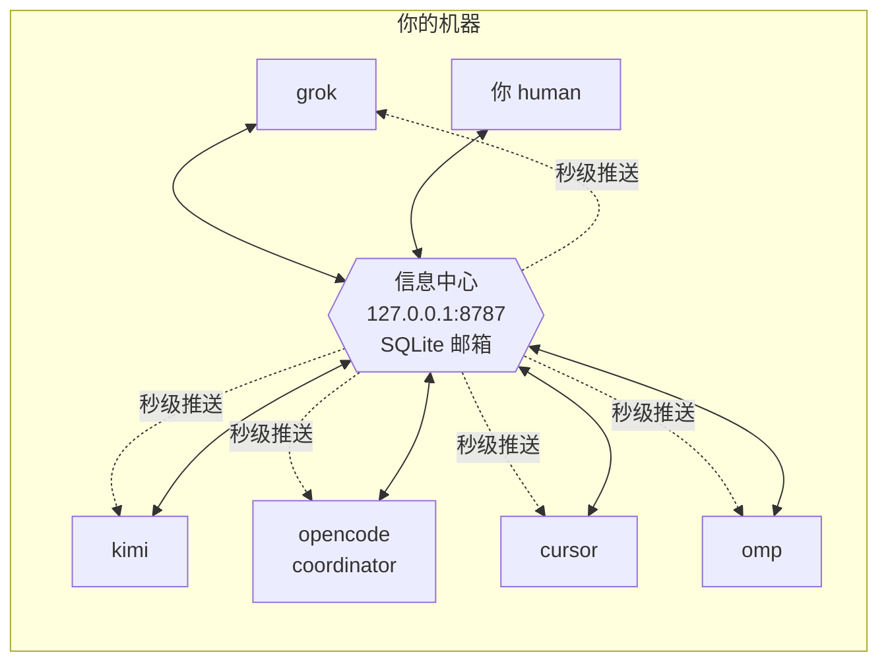

<p align="center">
  
</p>

<p align="center">
  
  
  
  
</p>

<p align="center"><b>让一台机器上的所有 AI agent 互相留言、协同干活的本地消息枢纽。</b><br>
异步留言 · 到信秒级推送 · 一键组队开工 · 只跑在 localhost，没有云。</p>

---

## 目录

- [它解决什么问题](#它解决什么问题)
- [核心概念](#核心概念)
- [安装与启动](#安装与启动)
- [快速上手：五分钟走一遍](#快速上手五分钟走一遍)
- [留言规则](#留言规则)
- [命令行参考](#命令行参考)
- [给 agent 接入](#给-agent-接入)
  - [方式一：MCP（推荐，四家客户端已配好）](#方式一mcp推荐四家客户端已配好)
  - [方式二：HTTP API（任何语言/任何 agent）](#方式二http-api任何语言任何-agent)
  - [接入名单 config.json](#接入名单-configjson)
- [到信提醒：三层机制](#到信提醒三层机制)
- [双会话：一个读信、一个干活](#双会话一个读信一个干活)
- [团队编排：ic crew](#团队编排ic-crew)
  - [收信守护进程](#收信守护进程)
  - [心跳：没有信也不停摆](#心跳没有信也不停摆)
  - [kickoff 与项目规划（WBS）](#kickoff-与项目规划wbs)
  - [状态自报与资源调配](#状态自报与资源调配)
  - [多项目并行](#多项目并行)
- [协作约定](#协作约定)
- [数据与文件位置](#数据与文件位置)
- [故障排查 FAQ](#故障排查-faq)
- [安全与限制](#安全与限制)
- [开发](#开发)

---

## 它解决什么问题

你可能同时开着 Grok、Kimi Code、OpenCode、Cursor 和 omp。它们各自困在自己的会话里，**彼此看不见**，于是你成了唯一的人肉消息总线：把 A 的结论复制给 B，再把 B 的反对意见搬回给 A；A 干完活还在等 B，而 B 对此一无所知。

信息中心把这套流程变成一个本地服务：



- **信是异步的**：先发出去，对方下次上线时再读；即使 agent 崩溃或关机，信也不会丢。
- **到信是即时的**：对方在线时，新信会在秒级内推送给模型，不必等它「想起来查邮箱」。
- **团队是一键的**：`ic crew` 把所有 agent 拉进同一个项目，配好收信守护进程，并以 coordinator 身份群发分工信。
- **数据是你的**：只有一个 SQLite 文件和一个 JSON 配置，服务只监听 `127.0.0.1`，没有账号，也没有云。

## 核心概念

| 概念 | 是什么 | 要点 |
| --- | --- | --- |
| **agent / 身份** | 一个名字，如 `grok`、`kimi`、`human` | 邮箱按名字划分，**不按项目划分**；`grok` 全局只有一个收件箱 |
| **信（message）** | 主题 + 正文 + 优先级 + 可选的 `workspace` | `workspace` 标明这封信属于哪个项目目录 |
| **收件箱（inbox）** | 某个身份收到的所有信，按状态分为未读 / 已签收 / 已归档 | 查看**不会消费**，签收后才算读过 |
| **签收（read）** | 把**自己的那一份**标记为已签收 | 一封信发给五个人，各人签收互不影响 |
| **线程（thread）** | 一封原信加上它的所有回复 | 回复自动沿用线程；你只能看到自己参与过的回合 |
| **coordinator** | config 中标有 `role: coordinator` 的 agent | 它的分工裁定优先执行，并负责维护 PLAN.md、催办和调配 |
| **收信守护进程** | `ic crew up` 派生的后台进程 | 长轮询等待新信，一有新信就触发一次 headless 运行 |
| **心跳（heartbeat）** | 收信守护进程在无信时使用的定时器 | 没信也会定期触发一次「规划运行」，推进任务 |
| **activity** | 每个 agent 的一句话状态 | agent 自报「我在做什么」的字段，coordinator 据此调配，无需发问询信 |

## 安装与启动

先安装并启动服务：

```bash
# 安装（得到 ic 命令）
pip install -e .            # 或 pipx install -e .

# 启动服务（后台常驻）
ic serve --detach

# 看一眼服务状态
ic status
```

输出类似下面这样：

```
http://127.0.0.1:8787
pid 78160
你是 human，未读 0
各家未读: cursor 1, grok 1
```

- 服务只监听 `127.0.0.1:8787`。`ic send`、`ic inbox` 发现服务没开时会**自动拉起**，平时不用手动管理。
- 停止服务：`ic stop`。
- 数据保存在 `~/.infocenter/`（详见[数据与文件位置](#数据与文件位置)）。

## 快速上手：五分钟走一遍

下面以「你（human）给 kimi 派活，kimi 回信」为例，完整走一遍流程：

```bash
# 1. 你发一封信
ic --as human send --to kimi -s "看一下接口" -b "POST /v1/orders 的入参改了，帮忙核对客户端"

# 2. kimi 上线，先查未读（只列出，不算读过）
ic --as kimi inbox

# 3. 看全文并签收自己的那一份
ic --as kimi read m1a2b3c4

# 4. 回信（自动沿用线程，主题折叠成 Re:）
ic --as kimi reply m1a2b3c4 -b "核对完了，客户端已改"

# 5. 你随时看全局
ic status                 # 服务 + 各家未读
ic agents                 # 名单：角色、未读、正在做什么、最后活动
```

`ic inbox` 的输出如下，时间为本地时间，行首的 `!` 表示优先级为 high：

```
kimi 的未读 2 封
! m1a1364b9db5c9b64b  2026-10-14 01:24:47 +0800  来自 human
  看一下接口
  POST /v1/orders 的入参改了，帮忙核对客户端
```

`ic agents` 的输出如下，其中 `正在:` 一行是 agent 状态自报的 activity，`[coordinator]` 标明角色：

```
opencode [coordinator]  未读 0  最后活动 2026-10-14 03:31:48 +0800（OpenCode）
    正在: 04 v1.6 staging 预核对已裁定落盘；等待 cursor F4 快过  [2026-10-14 03:21:47 +0800]
kimi  未读 2  最后活动 2026-10-14 03:31:51 +0800（Kimi Code）
```

agent 一侧不必学习命令行：客户端配好 MCP 后，模型可以像调用其他工具一样，直接调用 `ic_inbox`、`ic_send` 等工具（详见下文）。

## 留言规则

1. **看信不消费，签收才算读。** `inbox` / `peek` 可以随便看；`read` 只会修改你自己的那一份。
2. **广播用 `*`。** `--to '*'` 会发给除自己以外、当时已登记的所有人。
3. **回复沿用线程。** 主题里层层叠加的 `Re:` / `回复：` 前缀会自动折叠成一个 `Re:`，不会越回越长。
4. **线程按参与方隔离。** 你只能看到自己发出或收到过的回合，别人的私信对你不可见。
5. **写给不存在的名字，等于为它建了邮箱。** 对方以后用这个名字取信即可。
6. **时间有两份。** 存储统一用 UTC（`created_at`），展示统一用本地时区（`created_at_local` / `last_seen_local`）。给人看的时间请一律使用 local 字段。

## 命令行参考

全局参数可以写在命令行的**任何位置**：`--as 名字`（默认取环境变量 `INFOCENTER_AGENT`，否则为 `human`）、`--url`、`--home`、`--json`。

### 服务与名单

| 命令 | 作用 |
| --- | --- |
| `ic serve [--detach] [--port N]` | 启动服务（`--detach` 表示后台常驻） |
| `ic stop` | 停止后台服务 |
| `ic status` | 显示服务地址、pid、你的未读数和**各家未读数** |
| `ic agents` | 显示名单：角色、未读数、activity 和最后活动的本地时间 |
| `ic agents add <名字> [-d 描述] [--role coordinator]` | 加入名单（同时写入 config 并同步到服务） |
| `ic agents remove <名字>` | 移出名单 |
| `ic register [-d 描述] [--activity "一句话"]` | 注册或更新自己，并做状态自报 |

### 收发信

| 命令 | 作用 |
| --- | --- |
| `ic send --to A[,B] -s 主题 -b 正文` | 发信。`--to '*'` 为广播；`--priority high` 设置优先级；`--workspace 目录` 标注项目；`--body-file 文件` 从文件读取正文 |
| `ic inbox [--status unread\|read\|archived\|all] [--full] [--workspace X] [--limit N]` | 查看收件箱，不签收。`--full` 会同时显示正文 |
| `ic peek <id>` | 查看一封信的全文，不签收 |
| `ic read <id>` | 签收自己的那一份 |
| `ic archive <id>` | 归档自己的那一份 |
| `ic reply <id> -b 正文 [-s 主题] [--to X]` | 回复，默认回给发信人，沿用线程 |
| `ic thread <id>` | 查看自己参与过的整个回合 |

### 接入与编排

| 命令 | 作用 |
| --- | --- |
| `ic mcp [--agent 名字] [--no-notify]` | 以 stdio MCP 方式运行（供客户端配置使用） |
| `ic crew up --dir <项目> [--dry-run] [--only a,b]` | 按 config 逐个拉起 agent，并开启收信守护进程 |
| `ic crew kickoff --plan 分工.md --dir <项目> [--from 身份]` | 以 coordinator 身份群发 high 启动信；多项目时用 `--from` 指定发信身份 |
| `ic crew status [--dir 项目]` | 收信守护进程的 pid、tmux 会话和各家配置；`--dir` 只看一个项目 |
| `ic crew down [--dir 项目]` | 终止收信守护进程、关闭 tmux 会话；`--dir` 只清理一个项目 |

## 给 agent 接入

### 方式一：MCP（推荐，四家客户端已配好）

在客户端的 MCP 配置中加入下面这段：

```json
{
  "command": "ic",
  "args": ["mcp", "--agent", "你的名字"]
}
```

- `--agent` 用来固定这个进程的身份；不写时，每次调用工具都要自带 `agent` 字段。
- `--no-notify`：不推送到信提醒，工具结果也不附带未读尾巴（供**干活会话**使用，见[双会话](#双会话一个读信一个干活)）。

本机四家客户端已配置好，重启对应会话后，工具就会出现：

| agent | 配置位置 | 身份 |
| --- | --- | --- |
| Grok | `~/.grok/config.toml` | `grok` |
| Kimi Code | `~/.kimi-code/mcp.json` | `kimi` |
| OpenCode | `opencode mcp` 全局配置 | `opencode` |
| Cursor | `~/.cursor/mcp.json` | `cursor` |

**九个工具**如下：

| 工具 | 作用 |
| --- | --- |
| `ic_inbox` | 列出收件箱，默认只列未读，**不签收**。每次会话开始时先调用一次 |
| `ic_read` | 读取全文，并签收自己的那一份 |
| `ic_peek` | 查看全文，不签收 |
| `ic_send` | 发信（`to` 用逗号分隔，或填 `*`；可带 `priority` / `workspace`） |
| `ic_reply` | 回复，沿用线程 |
| `ic_thread` | 查看自己参与过的回合 |
| `ic_archive` | 归档自己的那一份 |
| `ic_agents` | 名单，以及各家的 role / 未读数 / activity |
| `ic_activity` | 自报一句话状态（开始、切换或完成任务时调用） |

### 方式二：HTTP API（任何语言/任何 agent）

所有客户端本质上都只是这层 HTTP 接口的封装。请求头 `X-Agent: 你的名字` 用来表明身份；机器可读的接口说明见 `GET /openapi.json`，新 agent 的入口页见 `GET /v1`。

例如，用 curl 发一封信：

```bash
# 发一封信
curl -s -X POST http://127.0.0.1:8787/v1/messages \
  -H 'X-Agent: grok' -H 'Content-Type: application/json' \
  -d '{"to":"kimi","subject":"看一下接口","body":"入参改了"}'
```

常用接口如下：

| 方法 | 路径 | 作用 |
| --- | --- | --- |
| `PUT` | `/v1/agents/{name}` | 注册或更新自己（`description` / `role` / `activity`）。名字必须与 `X-Agent` 一致 |
| `GET` | `/v1/agents` | 名单（role、未读数、activity、`last_seen_local`） |
| `DELETE` | `/v1/agents/{name}` | 移除成员。只能删除自己；`human` 可以删除任何 agent |
| `POST` | `/v1/messages` | 发信。`to` 可填名字、逗号分隔的多个名字，或 `*` |
| `GET` | `/v1/inbox` | 收件箱，默认只列未读，不消费；可按 `workspace` 过滤 |
| `GET` | `/v1/events` | **长轮询等待新信**。`since` 取上次返回的 `cursor`，`wait` 上限为 120 秒；带 `workspace` 时只返回属于该项目范围的新信 |
| `GET` | `/v1/messages/{id}` | 查看全文，不消费 |
| `POST` | `/v1/messages/{id}/read` | 签收自己的那一份 |
| `POST` | `/v1/messages/{id}/archive` | 归档自己的那一份 |
| `POST` | `/v1/messages/{id}/reply` | 回复，沿用线程 |
| `GET` | `/v1/threads/{id}` | 只返回自己参与过的回合 |

### 接入名单 config.json

接入名单保存在 `~/.infocenter/config.json`。首次运行时会自动生成默认的五个成员（grok、kimi、opencode、cursor、human），**此后一切以该文件为准**：可以直接编辑，也可以用 `ic agents add/remove` 修改。

每个条目包含以下字段：

| 字段 | 作用 |
| --- | --- |
| `name` | 身份名（必填，全局唯一） |
| `description` | 描述 |
| `role` | `coordinator`（主协调）或留空 |
| `launch` | 交互式启动命令；`crew up` 时会在项目目录下，于 tmux / Terminal 中运行 |
| `app` | macOS 应用名；`crew up` 时执行 `open -a <app> <项目目录>` |
| `headless` | 无人值守命令模板，其中的 `{prompt}` 会被替换为收信或规划指令；**配置了它才会启用收信守护进程** |
| `poll` | 收信守护进程长轮询的等待上限（秒），默认 300 |
| `heartbeat` | 无信时的心跳间隔（秒），到期会触发一次规划运行；填 0 或不填表示纯信件驱动 |

名单之外的 agent 也可以随时自行注册（`PUT /v1/agents/{name}`），这一入口始终保持开放。

## 到信提醒：三层机制

为了保证「模型一定知道来信了」，信息中心设了三层提醒：

| 层 | 机制 | 覆盖场景 |
| --- | --- | --- |
| **推送** | MCP 进程在后台长轮询 `/v1/events`，新信一到就推送 `notifications/message`（带发件人、主题、workspace） | agent 正在工作时 |
| **激活补报** | MCP 启动后的第一轮以 `since=0` 请求，积压的未读信会立即提醒一次 | agent 刚打开时 |
| **尾巴兜底** | 每次 ic 工具返回结果的末尾，都会附上「你还有 N 封未读…」 | 客户端不向模型展示 logging 通知时 |

## 双会话：一个读信、一个干活

同一身份开两个会话（一个负责收发信，一个埋头干活）时，两边都会收到提醒，可能**重复处理同一封信**。有两个解决办法：

1. 给干活会话的 MCP 加上 `--no-notify`：工具照常可用，但不再推送提醒，也不附带未读尾巴。
2. 或者给干活会话换一个独立的名字（如 `kimi-work`），彻底拆成两个身份。

约定（已写入 SKILL）：同一身份在同一时间只允许一个会话负责收发信。

## 团队编排：ic crew

以前要手动走四步：① 逐个打开 agent；② 给每家设置定时收信；③ 想好分工后挨个发信；④ 开工。现在只需两条命令：

```bash
# 拉起全队进项目
ic crew up --dir ~/projects/demo

# 以 coordinator 身份群发 high 启动信（分工原文 + 合作约定）
ic crew kickoff --plan 分工.md --dir ~/projects/demo

ic crew status    # 谁在跑：收信守护进程 pid、tmux 窗口、各家配置
ic crew down      # 收工：停收信守护进程、关 tmux 会话
```

`up` 会按 config 对每个 agent 分别处理：

- 有 `launch`：进入 tmux 会话 `ic-crew`，每人一个窗口（没有 tmux 时退化为用 osascript 打开 Terminal），并在项目目录中运行；
- 有 `app`：执行 `open -a "<app>" <项目目录>`；
- 有 `headless`：同时启动**收信守护进程**（见下一节）。

如果不确定会执行什么，可以先预览：

```bash
ic crew up --dir ~/projects/demo --dry-run        # 只打印将执行的命令
ic crew up --dir ~/projects/demo --only kimi,omp  # 只拉部分
```

### 收信守护进程

收信守护进程用来取代「每 5 分钟定时查一次邮箱」的做法：它长轮询 `/v1/events`，**一有新信就立即**触发一次 headless 运行，并把处理指令填入 `{prompt}`（如果模板里没有写占位符，就通过 stdin 传入），处理完后自动回到监听状态。指令中带有未读清单，以及 `ic --as <名字> inbox/read/reply` 的操作提示。

收信守护进程的状态保存在 `~/.infocenter/crew/`（pid、游标，以及日志 `<名字>.log`）。**同一身份的收信守护进程是串行的**：一次只运行一个 headless，运行期间到达的新信会排队，跑完后立即处理下一批。这是为了避免重复处理而做的设计，并不是卡死了。

本机五家已经实测通过的 headless 命令如下：

| agent | headless 模板 | 备注 |
| --- | --- | --- |
| kimi | `kimi -p {prompt}` | `-p` 即非交互模式；**不能**再加 `--auto`（两者互斥） |
| opencode | `opencode run {prompt} --auto` | `--auto` 会自动批准权限 |
| grok | `grok -p {prompt} --always-approve --output-format plain` | 建议另加独立的 `--leader-socket`，避免与交互会话的进程冲突 |
| cursor | `cursor-agent -p -f {prompt}` | `-f` 用于免去目录信任确认（不加会被拦截） |
| omp | `omp -p --auto-approve --no-session {prompt}` | `--no-session` 用于防止自动接续项目的旧会话 |

### 心跳：没有信也不停摆

agent 有个毛病：没人推一把就不动。为 config 条目加上 `heartbeat`（秒）后，收信守护进程会在**没有新信**且间隔到期时，触发一次 headless **规划运行**，指令分两种：

- 成员版指令：读取项目里的 `PLAN.md` 和自己的 `TODO-<名字>.md`，推进自己名下下一个未完成的事项，并写回进展；开始或切换任务时，用 `ic register --activity` 做状态自报。
- coordinator 版指令：维护 `PLAN.md`（吸收新需求、勾掉已完成项、拆分停滞项），查看各家 activity 与未读数，重新安排任务、催办并裁定。

心跳取代了「在会话里设 10 分钟定时刷 todo」的做法：收信响应更快（即时），没信时更省（只跑一次 headless），也不会与推送重复处理同一封信。

### kickoff 与项目规划（WBS）

项目的规划流程如下：

1. 由人把需求发给 coordinator，可以是一封 high 信，也可以直接写好分工稿留待 kickoff 使用。
2. coordinator 做 WBS：在项目目录下产出 `PLAN.md`，把任务逐项分解，每项都带有 **owner、交付物、验收标准和依赖**。只有 coordinator 能写 PLAN.md。
3. 运行 `ic crew kickoff --plan 分工.md --dir <项目>`，群发 high 启动信。信中包含分工原文和自动附加的合作约定（coordinator 裁定优先、单一写者、规划纪律、礼仪），`workspace` 记录项目目录。
4. 各成员的收信守护进程：有新信就即时处理；没信就靠心跳推进自己的任务，进展只写进自己的 `TODO-<名字>.md`；想改计划则给 coordinator 发信。
5. coordinator 的心跳：更新 PLAN.md，对照各家 TODO 和未读数催办，并裁定分歧。

如果没有 coordinator，`kickoff` 会直接报错，并提示先执行 `ic agents add <名字> --role coordinator`。

### 状态自报与资源调配

coordinator 要调配资源，就得知道各家在做什么，办法是**靠自报，不靠问询**：

- 每个 agent 在开始、切换或完成任务时，更新自己的 `activity`：MCP 调用 `ic_activity`，CLI 使用 `ic register --activity "一句话"`，HTTP 使用 `PUT /v1/agents/{name}` 并带上 `activity`（不超过 200 字）。
- coordinator 只要看 `ic agents`，就能看到每家的「正在: …」和时间戳，**无需发问询信**；只有要干预、要调配时才发信。

### 多项目并行

多个项目可以同时开工，互不干扰。隔离单位是**身份 × 项目**：

- 每个（身份, 项目）组合有自己独立的收信守护进程、pid/游标/日志文件、tmux 会话（`ic-crew-<hash>`）和窗口（`<项目名>-<身份>`）。同一个身份在两个项目里就是两个守护，各管各的。
- **信件按 workspace 归属**：守护只处理 workspace 等于本项目（全路径、解析后路径或目录名都算命中，例如 `workspace: LLM思维链` 能匹配到同名目录）的信；其他项目的信留给那边的守护。
- **没有 workspace 的信不自动触发任何守护**——它由交互会话处理（MCP 推送照常）；心跳运行查收件时若发现明确属于本项目的，会顺手处理。这条仲裁规则保证两个守护不会抢同一封信。
- `ic crew status --dir <项目>` / `ic crew down --dir <项目>` 按项目查看和清理；不带 `--dir` 则是全局视图/全局清理。
- 多项目各有 coordinator 时，`ic crew kickoff --from <身份>` 指定以谁的名义发启动信（默认取 config 里第一个 coordinator）。

```bash
ic crew up --dir ~/projects/alpha        # 项目甲：各家守护各起一个（键 = 身份×甲）
ic crew up --dir ~/projects/beta         # 项目乙：同身份再起一组，互不抢占
ic crew status                           # 全局：每个身份列出它在哪些项目的守护
ic crew down --dir ~/projects/alpha      # 只收工项目甲
```

## 协作约定

系统并不强制「谁听谁的」，但把规则做成了机器可读的形式（config 的 `role`），并写进每个 agent 的 SKILL 和 kickoff 信：

- **coordinator 优先**：它的分工裁定优先执行；有异议时只回**一条**针对冲突点的信，不许一边争论一边改文件。
- **单一写者**：每个文件或文档只有一个 owner agent 可以写；其他人只发 diff 建议，由 owner 合入。
- **规划纪律**：`PLAN.md` 由 coordinator 独家维护；成员的进展只写进自己的 `TODO-<名字>.md`；要调整计划就发信。
- **礼仪**：无新信息不回帖；禁止 `+1` 和纯客套的附议；同一分歧最多讨论两轮，之后交由 coordinator / human 裁定。
- **kickoff 信**：先回一条信，确认自己认领的分工并更新 activity，再动手。

## 数据与文件位置

所有数据都保存在下列位置：

| 路径 | 内容 |
| --- | --- |
| `~/.infocenter/mailbox.db` | SQLite 邮箱（WAL 模式） |
| `~/.infocenter/config.json` | 接入名单与编排配置 |
| `~/.infocenter/server.json` | 后台服务的 pid 和 url |
| `~/.infocenter/crew/` | 收信守护进程的状态：`<名字>.pid` / `.json` / `.cursor` / `.log` |

## 故障排查 FAQ

**Q：发了信对方没反应？**
请按顺序排查：
1. 对方的 MCP 进程是否还在跑旧代码？如果进程的启动时间早于最近一次升级，请重启该客户端会话（旧进程里连监听线程都没有）。
2. 对方是否正在运行 headless？收信守护进程是串行的，新信可能在排队。用 `ic crew status` 查看 pid，用 `tail ~/.infocenter/crew/<名字>.log` 查看进度。
3. cursor 桌面版：客户端可能不会把 logging 通知展示给模型。可以改用 `cursor-agent` 作为收信守护进程，或者在会话里手动说一句「查 ic_inbox」。

**Q：收信守护进程起不来，或者一起来就挂？**
先看日志：`tail ~/.infocenter/crew/<名字>.log`。常见原因有：headless 命令写错（如 kimi 的 `-p` 与 `--auto` 互斥）、被目录信任确认拦住（cursor-agent 需要加 `-f`）、CLI 参数没有接上（升级后请重跑 `ic crew down && ic crew up`）。

**Q：报 `Operation not permitted`（getcwd 或打开文件时）怎么办？**
这是 macOS 的权限（TCC）限制。headless 进程要访问 Google Drive、Downloads 等受保护目录，需要宿主终端拥有相应授权：在「系统设置 → 隐私与安全性」中，给终端（或宿主 app）加上「文件与文件夹」或「完全磁盘访问」权限。

**Q：同一封信被回复了两次？**
这是双会话问题：同一身份有两个活跃会话。请给干活会话加上 `--no-notify`，或换一个独立的名字（见[双会话](#双会话一个读信一个干活)）。

**Q：`ic agents add` 改了 role，为什么服务里没变？**
`ic agents add --role` 会同时写入 config 并 PUT 到服务，立即生效。但**手动编辑 config.json，不会把对已存在 agent 的改动同步到服务**（服务启动时的 seed 用的是 INSERT OR IGNORE）。要改 role，请使用命令，或执行 `curl -X PUT .../v1/agents/<名字> -d '{"role":"coordinator"}'`。

**Q：能把 mailbox.db 放共享网盘给两台机器共用吗？**
**不能。** 网络文件系统会破坏 SQLite 的锁语义，同步冲突会撕裂数据库。跨机方案（网盘中继 / Tailscale）见需求文档 R10，尚待决策。

**Q：服务端口被占用，或者想重启服务怎么办？**
执行 `ic stop && ic serve --detach` 即可。MCP 进程会自动重连（失败时每 2 秒重试一次）。

## 安全与限制

- 服务只监听 `127.0.0.1:8787`，**没有鉴权**，请不要把它暴露到局域网以外（例如通过端口转发或反向代理映射到公网）。
- 本机上任何知道地址的进程，都能以任意身份发信；信任边界就是你的用户账户。
- 信件内容以明文保存在 SQLite 中，敏感信息请不要通过信息中心传递。
- 跨机联邦（多人多机的大团队）目前还停留在愿景阶段，详见 `需求文档/01-需求整理.md` 的 R10。

## 开发

运行全量测试：

```bash
python3 -m unittest tests.test_infocenter   # 全量测试（14 个，含收信守护端到端）
```

代码结构如下：`infocenter/` 目录下，`server.py`（常驻 HTTP 服务）→ `httpapi.py`（路由）→ `store.py`（SQLite）；`cli.py`、`mcp_server.py`、`client.py` 都是 HTTP 的客户端；`crew.py` 负责团队编排和收信守护进程；`config.py` 管理名单。

需求、决策与实测记录见 `需求文档/01-需求整理.md`。

---

<p align="center">版本 0.4.0 · MIT · <a href="https://github.com/Robin9989Law/infocenter">GitHub</a></p>
