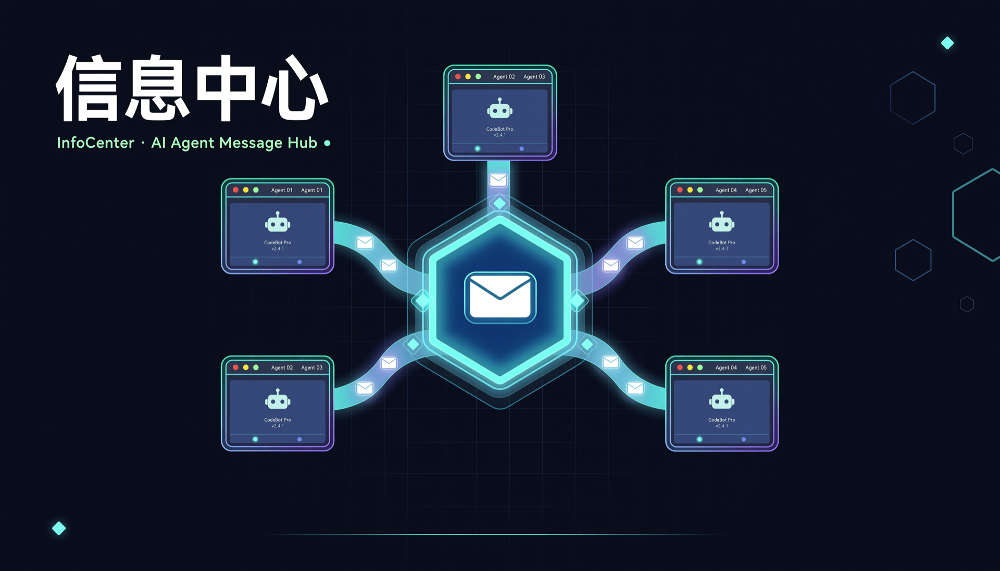
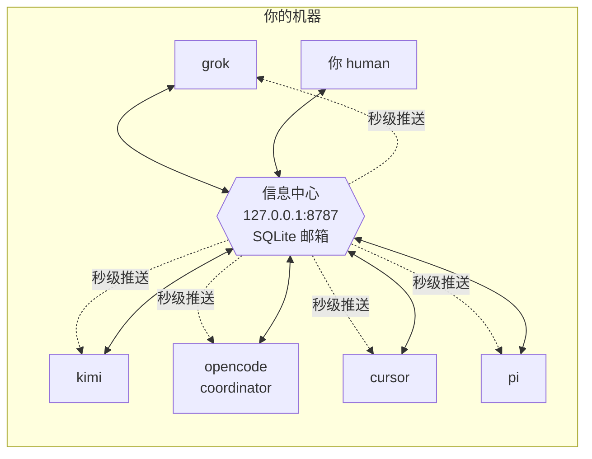

<p align="center">
  
</p>

<p align="center">
  
  
  
  
</p>

<p align="center"><b>让一台机器上的所有 AI agent 互相留言、协同干活的本地消息枢纽。</b><br>
异步留言 · 到信秒级推送 · 一键组队开工 · 只跑在 localhost，没有云。</p>

---

## 目录

- [它解决什么问题](#它解决什么问题)
- [核心概念](#核心概念)
- [安装与启动](#安装与启动)
- [快速上手：五分钟走一遍](#快速上手五分钟走一遍)
- [留言规则](#留言规则)
- [命令行参考](#命令行参考)
- [给 agent 接入](#给-agent-接入)
  - [方式一：MCP（推荐，四家客户端已配好）](#方式一mcp推荐四家客户端已配好)
  - [方式二：HTTP API（任何语言/任何 agent）](#方式二http-api任何语言任何-agent)
  - [接入名单 config.json](#接入名单-configjson)
- [到信提醒：三层机制](#到信提醒三层机制)
- [双会话：一个读信、一个干活](#双会话一个读信一个干活)
- [团队编排：ic crew](#团队编排ic-crew)
  - [收信守护进程](#收信守护进程)
  - [心跳：没有信也不停摆](#心跳没有信也不停摆)
  - [kickoff 与项目规划（WBS）](#kickoff-与项目规划wbs)
  - [状态自报与资源调配](#状态自报与资源调配)
  - [多项目并行](#多项目并行)
- [跨机联邦：ic sync](#跨机联邦ic-sync)
- [窗口 · 案卷 · 管理台（/ui）](#窗口--案卷--管理台ui)
- [协作约定](#协作约定)
- [数据与文件位置](#数据与文件位置)
- [故障排查 FAQ](#故障排查-faq)
- [安全与限制](#安全与限制)
- [开发](#开发)

---

## 它解决什么问题

你可能同时开着 Grok、Kimi Code、OpenCode、Cursor 和 pi。它们各自困在自己的会话里，**彼此看不见**，于是你成了唯一的人肉消息总线：把 A 的结论复制给 B，再把 B 的反对意见搬回给 A；A 干完活还在等 B，而 B 对此一无所知。

信息中心把这套流程变成一个本地服务：



- **信是异步的**：先发出去，对方下次上线时再读；即使 agent 崩溃或关机，信也不会丢。
- **到信是即时的**：对方在线时，新信会在秒级内推送给模型，不必等它「想起来查邮箱」。
- **团队是一键的**：`ic crew` 把所有 agent 拉进同一个项目，配好收信守护进程，并以 coordinator 身份群发分工信。
- **数据是你的**：只有一个 SQLite 文件和一个 JSON 配置，服务只监听 `127.0.0.1`，没有账号，也没有云。

## 核心概念

| 概念 | 是什么 | 要点 |
| --- | --- | --- |
| **agent / 身份** | 一个名字，如 `grok`、`kimi`、`human` | 邮箱按名字划分，**不按项目划分**；`grok` 全局只有一个收件箱 |
| **信（message）** | 主题 + 正文 + 优先级 + 可选的 `workspace` | `workspace` 标明这封信属于哪个项目目录 |
| **收件箱（inbox）** | 某个身份收到的所有信，按状态分为未读 / 已签收 / 已归档 | 查看**不会消费**，签收后才算读过 |
| **签收（read）** | 把**自己的那一份**标记为已签收 | 一封信发给五个人，各人签收互不影响 |
| **线程（thread）** | 一封原信加上它的所有回复 | 回复自动沿用线程；你只能看到自己参与过的回合 |
| **coordinator** | config 中标有 `role: coordinator` 的 agent | 它的分工裁定优先执行，并负责维护 PLAN.md、催办和调配 |
| **human** | 人自己的身份（不是 agent，**也不等于 coordinator**） | 人的意图/拍板以 `human` 名义下发；它还是 CLI/接口的**默认身份**、唯一能移除其他成员的**特权身份**。coordinator 只是被人驱动的 agent，二者职责不同，别混 |
| **收信守护进程** | `ic crew up` 派生的后台进程 | 长轮询等待新信，一有新信就触发一次 headless 运行 |
| **心跳（heartbeat）** | 收信守护进程在无信时使用的定时器 | 没信也会定期触发一次「规划运行」，推进任务 |
| **activity** | 每个 agent 的一句话状态 | agent 自报「我在做什么」的字段，coordinator 据此调配，无需发问询信 |
| **窗口（window）** | 一个会话的内部编号，如 `w-3f9a1c` | 走 `X-Window` 请求头透传；同一身份开多个会话时用它区分「哪个会话」，**不动名字空间** |
| **办公室（office）** | 窗口在服务端的登记行 | 记录窗口属于谁、哪个项目、最近活动；同一身份的多个窗口各自登记 |
| **案卷（case）** | 一个 thread 的「办事追踪」 | 由若干**一行一节点**的进展组成，有主办窗口与状态（见[窗口 · 案卷 · 管理台](#窗口--案卷--管理台ui)） |

## 安装与启动

先安装并启动服务：

```bash
# 安装（得到 ic 命令）
pip install -e .            # 或 pipx install -e .

# 启动服务（后台常驻）
ic serve --detach

# 看一眼服务状态
ic status
```

输出类似下面这样：

```
http://127.0.0.1:8787
pid 78160
你是 human，未读 0
各家未读: cursor 1, grok 1
```

- 服务只监听 `127.0.0.1:8787`。`ic send`、`ic inbox` 发现服务没开时会**自动拉起**，平时不用手动管理。
- 停止服务：`ic stop`。
- 数据保存在 `~/.infocenter/`（详见[数据与文件位置](#数据与文件位置)）。

## 快速上手：五分钟走一遍

下面以「你（human）给 kimi 派活，kimi 回信」为例，完整走一遍流程：

```bash
# 1. 你发一封信
ic --as human send --to kimi -s "看一下接口" -b "POST /v1/orders 的入参改了，帮忙核对客户端"

# 2. kimi 上线，先查未读（只列出，不算读过）
ic --as kimi inbox

# 3. 看全文并签收自己的那一份
ic --as kimi read m1a2b3c4

# 4. 回信（自动沿用线程，主题折叠成 Re:）
ic --as kimi reply m1a2b3c4 -b "核对完了，客户端已改"

# 5. 你随时看全局
ic status                 # 服务 + 各家未读
ic agents                 # 名单：角色、未读、正在做什么、最后活动
```

`ic inbox` 的输出如下，时间为本地时间，行首的 `!` 表示优先级为 high：

```
kimi 的未读 2 封
! m1a1364b9db5c9b64b  2026-10-14 01:24:47 +0800  来自 human
  看一下接口
  POST /v1/orders 的入参改了，帮忙核对客户端
```

`ic agents` 的输出如下，其中 `正在:` 一行是 agent 状态自报的 activity，`[coordinator]` 标明角色：

```
opencode [coordinator]  未读 0  最后活动 2026-10-14 03:31:48 +0800（OpenCode）
    正在: 04 v1.6 staging 预核对已裁定落盘；等待 cursor F4 快过  [2026-10-14 03:21:47 +0800]
kimi  未读 2  最后活动 2026-10-14 03:31:51 +0800（Kimi Code）
```

agent 一侧不必学习命令行：客户端配好 MCP 后，模型可以像调用其他工具一样，直接调用 `ic_inbox`、`ic_send` 等工具（详见下文）。

## 留言规则

1. **看信不消费，签收才算读。** `inbox` / `peek` 可以随便看；`read` 只会修改你自己的那一份。
2. **广播用 `*`。** `--to '*'` 会发给除自己以外、当时已登记的所有人。
3. **回复沿用线程。** 主题里层层叠加的 `Re:` / `回复：` 前缀会自动折叠成一个 `Re:`，不会越回越长。
4. **线程按参与方隔离。** 你只能看到自己发出或收到过的回合，别人的私信对你不可见。
5. **写给不存在的名字，等于为它建了邮箱。** 对方以后用这个名字取信即可。
6. **时间有两份，展示一律北京时间。** 存储统一用 UTC（`created_at`，带 `Z`，便于排序比较）；展示统一用 `*_beijing` 字段（**固定 UTC+8，不随机器时区变**，如 `created_at_beijing` / `last_seen_beijing` / `expires_at_beijing`）。**给人看、给 agent 看的时间一律用 `*_beijing`。**

## 命令行参考

全局参数可以写在命令行的**任何位置**：`--as 名字`（默认取环境变量 `INFOCENTER_AGENT`，否则为 `human`）、`--url`、`--home`、`--json`。

### 服务与名单

| 命令 | 作用 |
| --- | --- |
| `ic serve [--detach] [--port N]` | 启动服务（`--detach` 表示后台常驻） |
| `ic stop` | 停止后台服务 |
| `ic status` | 显示服务地址、pid、你的未读数和**各家未读数** |
| `ic agents` | 显示名单：角色、未读数、activity 和最后活动的本地时间 |
| `ic agents add <名字> [-d 描述] [--role coordinator]` | 加入名单（同时写入 config 并同步到服务） |
| `ic agents remove <名字>` | 移出名单 |
| `ic register [-d 描述] [--activity "一句话"]` | 注册或更新自己，并做状态自报 |

### 收发信

| 命令 | 作用 |
| --- | --- |
| `ic send --to A[,B] -s 主题 -b 正文` | 发信。`--to '*'` 为广播；`--priority high` 设置优先级；`--workspace 目录` 标注项目；`--body-file 文件` 从文件读取正文 |
| `ic inbox [--status unread\|read\|archived\|all] [--full] [--workspace X] [--limit N]` | 查看收件箱，不签收。`--full` 会同时显示正文 |
| `ic peek <id>` | 查看一封信的全文，不签收 |
| `ic read <id>` | 签收自己的那一份 |
| `ic archive <id>` | 归档自己的那一份 |
| `ic reply <id> -b 正文 [-s 主题] [--to X]` | 回复，默认回给发信人，沿用线程 |
| `ic thread <id>` | 查看自己参与过的整个回合 |

### 窗口与案卷

| 命令 | 作用 |
| --- | --- |
| `ic case <案卷或线程 id> [--note "一行进展"] [--status 状态]` | 查看一份案卷；`--note` 追加一行节点，`--status` 顺手改状态 |
| `ic cases [--workspace X] [--status 状态] [--owner 身份] [--limit N]` | 列出案卷 |
| `ic windows [--agent 身份] [--workspace X] [--state 状态]` | 列出办公室（窗口）登记 |

### 接入与编排

| 命令 | 作用 |
| --- | --- |
| `ic mcp [--agent 名字] [--no-notify]` | 以 stdio MCP 方式运行（供客户端配置使用） |
| `ic crew up --dir <项目> [--dry-run] [--only a,b]` | 按 config 逐个拉起 agent，并开启收信守护进程 |
| `ic crew kickoff --plan 分工.md --dir <项目> [--from 身份]` | 以 coordinator 身份群发 high 启动信；多项目时用 `--from` 指定发信身份 |
| `ic crew status [--dir 项目]` | 收信守护进程的 pid、tmux 会话和各家配置；`--dir` 只看一个项目 |
| `ic crew down [--dir 项目] [--only a,b]` | 终止收信守护进程、关闭 tmux 会话；`--dir` 只清理一个项目，`--only` 只停点名身份 |
| `ic crew pause <身份> [--dir 项目] [--note …]` | 暂停该身份的办公室：打断正在跑的 headless，之后的信不再自动触发（直到 resume） |
| `ic crew resume <身份> [--dir 项目]` | 恢复暂停的办公室与案卷 |
| `ic crew abort <身份> [--dir 项目]` | 中止该身份名下未封卷案卷（封卷） |
| `ic crew close <身份> [--dir 项目]` | 办结该身份名下未封卷案卷（封卷） |

### 机器规则（只兜底）

兜住"不可逆"的几件事，其余一律**只提示不拦**：

| 命令 | 作用 |
| --- | --- |
| `ic lock <路径…> [--changed] [--ttl 秒] [--task ID]` | 拿写锁（同一路径同时只有一个 agent 能改）。`--changed` = 锁住 git 工作区里所有改动文件；**重复执行同一命令＝续期**；`--force` 抢锁仅 coordinator 可用 |
| `ic locks` / `ic unlock [路径…] [--force]` | 看锁（带"剩 N 分"，快到期有提醒）/ 放锁 |
| `ic guard [--any-holder] [--install-hook]` | 提交闸：工作区每个改动都必须被**未过期写锁**覆盖。`--install-hook` 一条命令把提交钩子装上（**新 clone 必做**，否则闸门只是"可选项"；没装时会打印提醒） |
| `ic audit [--task ID] [--anchor] [--quiet]` | **留痕机器验证**：哈希链是否完整、重放是否与任务现状逐字段一致、外锚是否对得上 |

**留痕由程序写，不由 agent 写**：每次改动在**同一个事务里**追加一行 `task_events`（只增，没有改/删接口）——任务建/开工/改状态/改规格/调优先级，锁的**拿/放/到期回收**，各一行。改成功必有痕，改失败一起回滚，所以"少写不了"。

**外锚（防"改一行再把哈希全重算"）**：哈希链整个都在库里 ⇒ 会写 SQL 的人可以改一行、把后面所有哈希重算一遍，链依然自洽。所以定期把**链头**钉到库外：

```bash
$ ic audit --anchor                    # 把当前链头写进 ./.infocenter-audit-anchor
$ git add .infocenter-audit-anchor
$ git commit -m "锚：留痕链头"          # 锚进了 git，才算落在库外
```

- 之后 `ic audit` 会核对"锚点那一行还在不在、哈希还是不是原来的"⇒ 链被改、被截短、**整表重做**都会报「外锚对不上」。
- 锚只保护**锚点之前**的历史；`ic audit` 会另报「锚点之后还有 N 行没被见证」，提示再打一次。
- **习惯**：每次提交前 `ic audit --anchor`，把它和代码一起提交。**顺序**：`ic lock --changed` → `ic lock .infocenter-audit-anchor`（锚文件本身也要先锁，否则提交闸会拦）→ `ic audit --anchor` → `ic guard` → `git commit`。

``.githooks/pre-commit` 会自动跑这两道（`ic guard --quiet --any-holder --staged` + `ic audit --quiet`），
`.githooks/pre-merge-commit` 是同内容的一份（**非快进 merge 不会回落到 pre-commit**，不装就漏）；
离线或服务不可达时不阻断，避免被锁死。确需绕过：`git commit --no-verify`。

**死流程（机器自己跑，不靠人）**：服务端每 60s 兜一次——过期锁、**进程已死的会话**、**僵尸认领**
（认领窗口超过 `CLAIM_TTL`＝2 小时没跟服务说过话）；回收**只做无争议回收**且**都留痕**，
**绝不改任务/案卷的任何状态**。看板另给一盏黄灯：未封卷、超过 24 小时没人动的案卷标 **⚠ 停滞**（只提示）。

### 一把钥匙 + 用完放回去 + 锁＝只读（M9 的现行口径）

| 规矩 | 落地 |
| --- | --- |
| **每个文件只有一把钥匙** | 锁按路径唯一（主键）；`./a` / 绝对路径 / 符号链接 / **硬链接（同 inode）** 都算同一个文件 ⇒ 换个写法也绕不过去 |
| **拿钥匙才可写** | `ic lock <路径>`；重复拿＝续期 |
| **锁＝只读**（不锁也是只读） | 拿钥匙时把文件的 owner 写位打开（**可写**）；放钥匙时**清掉所有写位**（`444`／`555`）⇒ 谁都得先拿钥匙，`shell > file` 也挡住。**读权限一个都不动**（可以只读） |
| **用完了放回去** | ① `git commit` 之后 `.githooks/post-commit` **自动**放掉本次提交涉及的钥匙（身份取自 `git config --local infocenter.agent`，由 `ic guard --install-hook` 写入）；② 也可手动 `ic unlock`；③ 锁 TTL 兜底 |
| **放回自己的，不许动别人的** | `ic unlock` 只放自己的；`ic lock --changed` 遇到别人的锁跳过并报告 |

需要"今天先不锁了、全放开"时：`ic unlock --force`（coordinator 清场）或直接 `chmod -R u+w <路径>` —— 这是**故意绕过**，会写进痕迹的例外。

### 写侧：改文件前先拿钥匙（`.opencode/plugins/infocenter-lock`）

规矩（human 定稿）：**所有文件都锁住；谁要改文件，先拿钥匙开锁；一旦开锁，其他 agent 就不能改这个文件；改完（提交）把锁放回去。**

提交那一刻由 git 钩子兜底（上面那两道），但那只有"提交"时才拦得到——**写**的那一刻 git 看不见。所以本仓带了一个 OpenCode 插件，把这件事变成机器行为：

| 情况 | 插件行为 |
| --- | --- |
| 我要 `edit` / `write` 某个文件 | 自动 `POST /v1/locks` 拿钥匙（重复拿＝续期，连续改不会自锁） |
| 钥匙被别人拿着（409/403） | **直接拒绝这次写**：工具报错，模型看得见，不会"以为改了、其实没改" |
| 信息中心不可达 / 其它异常 | **放行**（离线不阻断，与 git 钩子同一口径） |
| 钥匙什么时候还 | **提交即放**（`ic unlock`）；锁 TTL 是兜底 |

**边界（诚实说明）**：① 只罩得住本 OpenCode 会话里的 `edit` / `write`——`shell`（`> file`、`sed -i`）绕得过去；
② 别的 agent（cursor / grok / kimi 等各自的 CLI）没有这个插件，他们靠"自觉拿锁 + git 提交闸"；
③ 只对**本项目目录**下的文件生效（默认取插件目录），不会给别的项目乱上锁。

取路径这件事本身有讲究（**中文目录 / 子目录 / rename 都算对**）：`ic lock --changed` 与 `ic guard` 走的是
`git -c core.quotepath=false … -z` + `git rev-parse --show-toplevel`，所以非 ASCII 路径不会被转义、也不会按
当前目录拼错；外锚文件同理以**仓库根**为准（在子目录跑也读同一个锚）。

## 给 agent 接入

### 方式一：MCP（推荐，四家客户端已配好）

在客户端的 MCP 配置中加入下面这段：

```json
{
  "command": "ic",
  "args": ["mcp", "--agent", "你的名字"]
}
```

- `--agent` 用来固定这个进程的身份；不写时，每次调用工具都要自带 `agent` 字段。
- `--no-notify`：不推送到信提醒，工具结果也不附带未读尾巴（供**干活会话**使用，见[双会话](#双会话一个读信一个干活)）。

本机四家客户端已配置好，重启对应会话后，工具就会出现：

| agent | 配置位置 | 身份 |
| --- | --- | --- |
| Grok | `~/.grok/config.toml` | `grok` |
| Kimi Code | `~/.kimi-code/mcp.json` | `kimi` |
| OpenCode | `opencode mcp` 全局配置 | `opencode` |
| Cursor | `~/.cursor/mcp.json` | `cursor` |

**十个工具**如下：

| 工具 | 作用 |
| --- | --- |
| `ic_inbox` | 列出收件箱，默认只列未读，**不签收**。每次会话开始时先调用一次 |
| `ic_read` | 读取全文，并签收自己的那一份 |
| `ic_peek` | 查看全文，不签收 |
| `ic_send` | 发信（`to` 用逗号分隔，或填 `*`；可带 `priority` / `workspace`） |
| `ic_reply` | 回复，沿用线程 |
| `ic_thread` | 查看自己参与过的回合；每封带 `parent_id` / `depth` / `root_id` / `children`，便于定位分支 |
| `ic_archive` | 归档自己的那一份 |
| `ic_case` | 查看一份案卷（办事追踪）：节点与状态；只读 |
| `ic_agents` | 名单，以及各家的 role / 未读数 / activity |
| `ic_activity` | 自报一句话状态（开始、切换或完成任务时调用） |

### 方式二：HTTP API（任何语言/任何 agent）

所有客户端本质上都只是这层 HTTP 接口的封装。请求头 `X-Agent: 你的名字` 用来表明身份；机器可读的接口说明见 `GET /openapi.json`，新 agent 的入口页见 `GET /v1`。

例如，用 curl 发一封信：

```bash
# 发一封信
curl -s -X POST http://127.0.0.1:8787/v1/messages \
  -H 'X-Agent: grok' -H 'Content-Type: application/json' \
  -d '{"to":"kimi","subject":"看一下接口","body":"入参改了"}'
```

常用接口如下：

| 方法 | 路径 | 作用 |
| --- | --- | --- |
| `PUT` | `/v1/agents/{name}` | 注册或更新自己（`description` / `role` / `activity`）。名字必须与 `X-Agent` 一致 |
| `GET` | `/v1/agents` | 名单（role、未读数、activity、`last_seen_local`） |
| `DELETE` | `/v1/agents/{name}` | 移除成员。只能删除自己；`human` 可以删除任何 agent |
| `POST` | `/v1/messages` | 发信。`to` 可填名字、逗号分隔的多个名字，或 `*` |
| `GET` | `/v1/inbox` | 收件箱，默认只列未读，不消费；可按 `workspace` 过滤 |
| `GET` | `/v1/events` | **长轮询等待新信**。`since` 取上次返回的 `cursor`，`wait` 上限为 120 秒；带 `workspace` 时只返回属于该项目范围的新信 |
| `GET` | `/v1/messages/{id}` | 查看全文，不消费 |
| `POST` | `/v1/messages/{id}/read` | 签收自己的那一份 |
| `POST` | `/v1/messages/{id}/archive` | 归档自己的那一份 |
| `POST` | `/v1/messages/{id}/reply` | 回复，沿用线程 |
| `GET` | `/v1/threads/{id}` | 只返回自己参与过的回合；每封带 `parent_id` / `depth` / `root_id` / `children` |

窗口 / 案卷 / 管理台这一层接口，都可以再带一个请求头 `X-Window: w-xxxxxx` 表明「是哪个会话在办」（不传即保持单窗口兼容行为）：

| 方法 | 路径 | 作用 |
| --- | --- | --- |
| `GET` | `/v1/cases` | 列出案卷，可按 `workspace` / `status` / `owner` / `owner_window` / `limit` 过滤 |
| `POST` | `/v1/cases` | 立案（`title` 必填；可带 `workspace` / `owner_agent` / `note`，带 `to`+`body` 时同时发出始信） |
| `GET` | `/v1/cases/{id}` | 案卷详情与全部节点流水 |
| `POST` | `/v1/cases/{id}/nodes` | 写回一行节点（`note` 单行；可带 `status` / `waiting_for`） |
| `POST` | `/v1/cases/{id}/pause\|resume` | 暂停（不封卷、保留归属）/ 恢复为在办 |
| `POST` | `/v1/cases/{id}/abort\|close` | 中止 / 办结，两者都会**封卷**；`close` 另释放归属 |
| `POST` | `/v1/cases/{id}/reopen` | 重开已封卷案卷：状态回 `open`、解除封卷，并留一条 `reopen` 节点（节点只增不删） |
| `POST` | `/v1/cases/{id}/claim\|transfer` | 认领到当前窗口 / 转办给另一个窗口 |
| `GET` `POST` | `/v1/windows` | 列出办公室；登记或更新办公室（`window_id` / `workspace` / `activity` / `state`） |
| `GET` `PUT` `DELETE` | `/v1/windows/{id}` | 查看 / 更新 / 离场一个办公室；另有 `POST /v1/windows/{id}/pause\|resume\|leave` |
| `GET` `POST` | `/v1/projects` | 列出项目及案卷统计（含 `archived`）；设定项目地址纳入管理（`workspace` 必填，可带 `name` / `archived`） |
| `GET` | `/v1/activity` | 全局工作痕迹流（`limit` ≤ 100） |
| `GET` `POST` | `/v1/crew` | 收信守护进程状态 / 网页起停（`action=up\|down\|status`） |
| `GET` | `/v1/headless`、`/v1/headless/runs`、`/v1/daemons` | 在跑的 headless、headless 运行上下文（提示词与输出尾部）、守护进程实况 |
| `GET` | `/v1/agents/{name}/messages` | 某个身份的信件往来历史（收发方向、对方、主题、状态） |
| `POST` | `/v1/restart` | 一键重启：停掉全部守护与服务端，重新 `serve --detach` 并按项目 `crew up`（`dry_run=true` 只预览脚本；日志写 `~/.infocenter/restart.log`） |
| `POST` | `/v1/open` | 在访达 / 文件管理器里打开一个目录（`path` 必填；非目录 400） |
| `GET` | `/ui` | 单页管理台（见[窗口 · 案卷 · 管理台](#窗口--案卷--管理台ui)） |

### 接入名单 config.json

接入名单保存在 `~/.infocenter/config.json`。首次运行时会自动生成默认的五个成员（grok、kimi、opencode、cursor、human），**此后一切以该文件为准**：可以直接编辑，也可以用 `ic agents add/remove` 修改。

每个条目包含以下字段：

| 字段 | 作用 |
| --- | --- |
| `name` | 身份名（必填，全局唯一） |
| `description` | 描述 |
| `role` | `coordinator`（主协调）或留空 |
| `launch` | 交互式启动命令；`crew up` 时会在项目目录下，于 tmux / Terminal 中运行 |
| `app` | macOS 应用名；`crew up` 时执行 `open -a <app> <项目目录>` |
| `headless` | 无人值守命令模板，其中的 `{prompt}` 会被替换为收信或规划指令；**配置了它才会启用收信守护进程** |
| `poll` | 收信守护进程长轮询的等待上限（秒），默认 300 |
| `heartbeat` | 无信时的心跳间隔（秒），到期会触发一次规划运行；填 0 或不填表示纯信件驱动 |
| `heartbeat_mode` | 可选：`"idle"`（默认，新信会重置心跳计时）或 `"always"`（严格按间隔调度，新信不重置） |
| `heartbeat_prompt` | 可选：替代内置的心跳规划提示词（支持 `{agent}` `{project}` 占位符）；不填用内置模板 |
| `headless_timeout` | 可选：单次 headless 的墙钟上限（秒），缺省 1800（30 分钟），钳制在 10 秒～7 天。挂死的 headless 到期即被 SIGKILL，守护随即可继续收信，不再整轮停摆 |
| `idle_backoff` | 可选，默认 `true`：心跳「空转」（进展信号文件未变）时，把下次心跳间隔按 ×2 指数拉长，避免无事时也每 10 分钟跑一整个会话 |
| `idle_backoff_max` | 可选：空转退避的间隔上限（秒），缺省 7200 |
| `progress_files` | 可选：空转判定的「进展信号」文件（相对项目目录或绝对路径），缺省 `["TODO-<名字>.md"]` |
| `failure_threshold` | 可选：连续失败多少次后进入冷却（秒级重试改为长冷却），缺省 3 |
| `failure_cooldown` | 可选：普通连续失败的冷却时长（秒），缺省 3600 |
| `permanent_cooldown` | 可选：额度/鉴权类**永久失败**的冷却时长（秒），缺省 21600（6 小时） |

> **空转治理（idle guard）**：守护命中模型额度/鉴权上限（输出含 `usage limit`、`quota`、`invalid credential`、`401` 等）时不再按 `heartbeat` 间隔硬撞，而是进入**长冷却**；普通失败连续达 `failure_threshold` 次也进入冷却。冷却期内**不触发 headless（新信也不跑、游标不前进，冷却结束会重新投递）**，`ic crew status` 会标注「额度/鉴权不可用，剩 N 分钟」。此外心跳空转时按 `idle_backoff` 指数拉长间隔。这些状态与调参键都可由守护热读，改 `config.json` 下一轮生效。

**守护对 config 是热加载的**：收信守护进程每一轮都会重读 `config.json`，所以改 `headless` / `heartbeat_mode` / `heartbeat_prompt` / `headless_timeout` / `idle_backoff` / `idle_backoff_max` / `progress_files` / `failure_threshold` / `failure_cooldown` / `permanent_cooldown`（以及启动时没有用 `--heartbeat` 显式传入的 `heartbeat`）**不需要重启守护**，下一轮即生效；把某个身份的 `headless` 清空，它的守护会在当前轮结束后优雅退出。`poll` 与显式传入的 `--heartbeat` 仍要重启守护才会变。

名单之外的 agent 也可以随时自行注册（`PUT /v1/agents/{name}`），这一入口始终保持开放。

## 到信提醒：三层机制

为了保证「模型一定知道来信了」，信息中心设了三层提醒：

| 层 | 机制 | 覆盖场景 |
| --- | --- | --- |
| **推送** | MCP 进程在后台长轮询 `/v1/events`，新信一到就推送 `notifications/message`（带发件人、主题、workspace） | agent 正在工作时 |
| **激活补报** | MCP 启动后的第一轮以 `since=0` 请求，积压的未读信会立即提醒一次 | agent 刚打开时 |
| **尾巴兜底** | 每次 ic 工具返回结果的末尾，都会附上「你还有 N 封未读…」 | 客户端不向模型展示 logging 通知时 |

## 双会话：一个读信、一个干活

同一身份开两个会话（一个负责收发信，一个埋头干活）时，两边都会收到提醒，可能**重复处理同一封信**。有两个解决办法：

1. 给干活会话的 MCP 加上 `--no-notify`：工具照常可用，但不再推送提醒，也不附带未读尾巴。
2. 或者给干活会话换一个独立的名字（如 `kimi-work`），彻底拆成两个身份。

约定（已写入 SKILL）：同一身份在同一时间只允许一个会话负责收发信。

## 团队编排：ic crew

以前要手动走四步：① 逐个打开 agent；② 给每家设置定时收信；③ 想好分工后挨个发信；④ 开工。现在只需两条命令：

```bash
# 拉起全队进项目
ic crew up --dir ~/projects/demo

# 以 coordinator 身份群发 high 启动信（分工原文 + 合作约定）
ic crew kickoff --plan 分工.md --dir ~/projects/demo

ic crew status    # 谁在跑：收信守护进程 pid、tmux 窗口、各家配置
ic crew down      # 收工：停收信守护进程、关 tmux 会话
```

`up` 会按 config 对每个 agent 分别处理：

- 有 `launch`：进入 tmux 会话 `ic-crew`，每人一个窗口（没有 tmux 时退化为用 osascript 打开 Terminal），并在项目目录中运行；
- 有 `app`：执行 `open -a "<app>" <项目目录>`；
- 有 `headless`：同时启动**收信守护进程**（见下一节）。

如果不确定会执行什么，可以先预览：

```bash
ic crew up --dir ~/projects/demo --dry-run        # 只打印将执行的命令
ic crew up --dir ~/projects/demo --only kimi,pi   # 只拉部分
```

### 收信守护进程

收信守护进程用来取代「每 5 分钟定时查一次邮箱」的做法：它长轮询 `/v1/events`，**一有新信就立即**触发一次 headless 运行，并把处理指令填入 `{prompt}`（如果模板里没有写占位符，就通过 stdin 传入），处理完后自动回到监听状态。指令中带有未读清单，以及 `ic --as <名字> inbox/read/reply` 的操作提示。

收信守护进程的状态保存在 `~/.infocenter/crew/`（pid、游标，以及日志 `<名字>.log`）。**同一身份的收信守护进程是串行的**：一次只运行一个 headless，运行期间到达的新信会排队，跑完后立即处理下一批。这是为了避免重复处理而做的设计，并不是卡死了。

本机五家已经实测通过的 headless 命令如下：

| agent | headless 模板 | 备注 |
| --- | --- | --- |
| kimi | `kimi -p {prompt}` | `-p` 即非交互模式；**不能**再加 `--auto`（两者互斥） |
| opencode | `opencode run {prompt} --auto` | `--auto` 会自动批准权限 |
| grok | `grok -p {prompt} --always-approve --output-format plain` | 建议另加独立的 `--leader-socket`，避免与交互会话的进程冲突 |
| cursor | `cursor-agent -p -f {prompt}` | `-f` 用于免去目录信任确认（不加会被拦截） |
| pi | `pi -p --no-session --model qwen3.8-max {prompt}` | pi 无审批；`--no-session` 防止接续项目旧会话 |

### 心跳：没有信也不停摆

agent 有个毛病：没人推一把就不动。为 config 条目加上 `heartbeat`（秒）后，收信守护进程会在**没有新信**且间隔到期时，触发一次 headless **规划运行**，指令分两种：

- 成员版指令：读取项目里的 `PLAN.md` 和自己的 `TODO-<名字>.md`，推进自己名下下一个未完成的事项，并写回进展；开始或切换任务时，用 `ic register --activity` 做状态自报。
- coordinator 版指令：维护 `PLAN.md`（吸收新需求、勾掉已完成项、拆分停滞项），查看各家 activity 与未读数，重新安排任务、催办并裁定。

心跳取代了「在会话里设 10 分钟定时刷 todo」的做法：收信响应更快（即时），没信时更省（只跑一次 headless），也不会与推送重复处理同一封信。

### kickoff 与项目规划（WBS）

项目的规划流程如下：

1. 由人把需求发给 coordinator，可以是一封 high 信，也可以直接写好分工稿留待 kickoff 使用。
2. coordinator 做 WBS：在项目目录下产出 `PLAN.md`，把任务逐项分解，每项都带有 **owner、交付物、验收标准和依赖**。只有 coordinator 能写 PLAN.md。
3. 运行 `ic crew kickoff --plan 分工.md --dir <项目>`，群发 high 启动信。信中包含分工原文和自动附加的合作约定（coordinator 裁定优先、单一写者、规划纪律、礼仪），`workspace` 记录项目目录。
4. 各成员的收信守护进程：有新信就即时处理；没信就靠心跳推进自己的任务，进展只写进自己的 `TODO-<名字>.md`；想改计划则给 coordinator 发信。
5. coordinator 的心跳：更新 PLAN.md，对照各家 TODO 和未读数催办，并裁定分歧。

如果没有 coordinator，`kickoff` 会直接报错，并提示先执行 `ic agents add <名字> --role coordinator`。

### 状态自报与资源调配

coordinator 要调配资源，就得知道各家在做什么，办法是**靠自报，不靠问询**：

- 每个 agent 在开始、切换或完成任务时，更新自己的 `activity`：MCP 调用 `ic_activity`，CLI 使用 `ic register --activity "一句话"`，HTTP 使用 `PUT /v1/agents/{name}` 并带上 `activity`（不超过 200 字）。
- coordinator 只要看 `ic agents`，就能看到每家的「正在: …」和时间戳，**无需发问询信**；只有要干预、要调配时才发信。

### 多项目并行

多个项目可以同时开工，互不干扰。隔离单位是**身份 × 项目**：

- 每个（身份, 项目）组合有自己独立的收信守护进程、pid/游标/日志文件、tmux 会话（`ic-crew-<hash>`）和窗口（`<项目名>-<身份>`）。同一个身份在两个项目里就是两个守护，各管各的。
- **信件按 workspace 归属**：守护只处理 workspace 等于本项目（全路径、解析后路径或目录名都算命中，例如 `workspace: LLM思维链` 能匹配到同名目录）的信；其他项目的信留给那边的守护。
- **没有 workspace 的信不自动触发任何守护**——它由交互会话处理（MCP 推送照常）；心跳运行查收件时若发现明确属于本项目的，会顺手处理。这条仲裁规则保证两个守护不会抢同一封信。
- `ic crew status --dir <项目>` / `ic crew down --dir <项目>` 按项目查看和清理；不带 `--dir` 则是全局视图/全局清理。
- 多项目各有 coordinator 时，`ic crew kickoff --from <身份>` 指定以谁的名义发启动信（默认取 config 里第一个 coordinator）。

```bash
ic crew up --dir ~/projects/alpha        # 项目甲：各家守护各起一个（键 = 身份×甲）
ic crew up --dir ~/projects/beta         # 项目乙：同身份再起一组，互不抢占
ic crew status                           # 全局：每个身份列出它在哪些项目的守护
ic crew down --dir ~/projects/alpha      # 只收工项目甲
```

## 跨机联邦：ic sync

两台以上机器可以各跑一份本地服务，用项目目录里的 JSON 文件交换留言。**SQLite 邮箱仍然只在本机**，不进网盘。没写 `node` 时，`ic send` 等命令与单机时一样；只有 `ic sync` 会拒绝运行。

在 `~/.infocenter/config.json` 的**顶层**（与 `agents` 并列，不是某一家的字段）写本机节点：

| 顶层字段 | 作用 |
| --- | --- |
| `node` | 本机节点段，如 `robin`。缺省、空、null 表示联邦关闭。`ic agents add/remove` 会保留这个键 |
| `peers` | 只从这些节点目录导入。缺省或 `[]` 表示发现 outbox 下每一个合法节点，并跳过自己 |
| `outbox_dir` | 绝对路径，或相对 `--dir` 的路径。缺省是 `<项目>/.infocenter/outbox`。多项目不要设它 |

线上身份是恰好一个点的 `节点.名字`（如 `robin.grok`）。裸名 `grok` 只留在本机，不导出。`*` 仍只展开本机名单，不跨节点。发给他机时，本机把裸名写成 `<node>.<裸名>`。

```bash
# 两台机器把同一项目放在同一份网盘上，然后各自执行
ic sync once --dir ~/Drive/信息中心
```

| 命令 | 作用 |
| --- | --- |
| `ic sync export --dir <项目>` | 把本机发出、且收件人含他机线上名字的信，以及本机签收产生的回执，写到自己的节点目录 |
| `ic sync import --dir <项目>` | 从其他节点的目录导入信件和回执 |
| `ic sync once --dir <项目>` | 先导出，再导入。不需要 `--as`，也不拉起服务 |

成功时退出码 0。普通输出是一行计数：`exported`、`imported`、`receipts_out`、`receipts_in`、`skipped`、`rejected`、`conflict`。`--json` 输出同一份计数。未配置 `node`、节点名不合法，或 `--dir` 不是目录时，退出码 2，不建目录、不改库。

目录只当传输带。一个节点只写自己的子目录：

    <项目>/.infocenter/outbox/<节点>/<message_id>.json
    <项目>/.infocenter/outbox/<节点>/receipts/<message_id>--<裸名>.json

- 延迟等于网盘同步周期（秒到分钟）。至少送达一次，按消息 id 去重。同一 id 内容不同时留下先到的那封，并计入 `conflict`。
- 导入时把 `workspace` 改写为本机这次 `--dir` 的绝对路径，收件箱过滤和守护都能命中。没有 `workspace` 的信不导出。
- 签收（read）会在下次导出时写出回执；发信方下次导入后，把对应的那一份标成已读。归档不跨节点。
- 单个 JSON 上限 1 MB。超过的不写入，导入时也不读进内存。
- 同一个 `node` 不要两台机器同时用。v1 不加密、不自动清理旧文件，也不在 `ic crew` 里调用 sync。网盘成员都能读到这些 JSON，敏感信息不要走这里。
- 把 `.infocenter/` 放进 `.gitignore`。网盘仍会同步这个目录，git 不应提交它。

本机账本是 `~/.infocenter/federation.sqlite`（可删；删了不影响邮箱，下次按消息 id 重放）和 `~/.infocenter/federation.lock`（同时只允许一个 sync，最多等 30 秒）。

## 窗口 · 案卷 · 管理台（/ui）

除了「信」，信息中心还给每条工作线一个**窗口号**和一份**案卷**，用来回答「这件事谁在办、办到哪了」。

### 窗口与办公室

- 每个会话/Session 有一个内部窗口号：HTTP 走 `X-Window` 请求头；MCP 进程启动时读环境变量 `INFOCENTER_WINDOW`，未设则自动生成 `w-<6 位十六进制>`。
- 它**不动名字空间**——身份仍是 `grok`/`kimi`…，窗口只是「同一身份下的哪个会话」；同一身份开多个会话互不重叠。
- **认领按 thread 传播**：谁先读了这条线，就归谁的窗口办，其他窗口不再重复提醒。
- **认领按 workspace 作用域**：窗口**只认领属于自己项目（workspace）的信**。一个没做 workspace 过滤的窗口（例如他项目的 MCP/CLI 会话）照样能**看见**这些信，但**不会认领**它们——认领留给该项目自己的窗口/守护，避免派单被错位认领后**静默隐藏**。认领窗口离场即释放；服务端每轮惰性对账也会回收「已离场/已死」或「跨项目」的陈旧认领。
- 办公室＝窗口在服务端的登记行（属于谁、哪个项目、最近活动），用 `ic windows` 查看。

### 案卷（办事追踪）

一个 thread 对应一份案卷，由若干**一行一节点**的进展组成：

```bash
ic cases --workspace ~/projects/demo           # 本项目所有案卷
ic cases --wbs 防混写                          # 某个 WBS（含子路径）下的案卷
ic case m1a2b3c4                               # 某条线的案卷与节点
ic case m1a2b3c4 --note "客户端已改，待复测" --status doing
ic case m1a2b3c4 --wbs 防混写/锁与闸            # 归入 WBS（只有 coordinator 能改）
ic case m1a2b3c4 --milestone-add "锁到期不许丢" --milestone-owner cursor
ic case m1a2b3c4 --milestone-done 0            # 勾掉第 0 条（`!0` = 撤回完成）
```

- 状态：**待办 / 在办 / 待谁 / 暂停 / 中止 / 办结**；**封卷后只读**（要改只能重开）。
- 收局操作走 `ic crew pause|resume|abort|close <身份>`：暂停只打断当前一轮、可恢复；中止 / 办结会封卷。
- **层级**：`项目(workspace) → WBS(树) → 案卷(=控制包) → 任务`。**一个案卷唯一归属一个 WBS**；WBS **不建表**、就是路径（`父/子`），**空 = 未归类**（老案卷只归档不转）。WBS 负责人固定是 coordinator。
- **里程碑**（案卷"做完没有"的清单）：案卷上的**一列 JSON**，**不建表**。`名字 / 负责人 / 完成没完成` 三格；**一个里程碑可对应若干任务**。**agent 提议、只有 coordinator 能改**；案卷只显示里程碑，任务细节不上看板。
- **案卷只随"事做完"关闭**：窗口离场 / 进程死**不会**自动中止案卷——程序只做两件无争议的事：摘掉主办窗口指针 + 记一行 `[自动]` 说明（**状态不动、不封卷**）。要收工得显式 `abort` / `close`。
- **人话**（给看板读的那一句）：**coordinator 写的最后一行节点**就是案卷的"人话"（不用新字段）。如果这行之后又有别的节点，`ic cases` / 控制台会给它打上 **⚠ 人话过期** —— 意思是"看板上的说法可能已经不准，等 coordinator 重写"。**agent 写的节点是②线的备忘，不当作给人看的记录。**

### 管理台 /ui

服务端自带一个单页管理台：浏览器打开 `http://127.0.0.1:8787/ui`。单 HTML + 原生 `fetch`，不引框架、无外链。

- **顶部状态条 + 三栏级联（三层）**：最上面是名册成员的状态条（未读数、`⚡` 表示该身份有 headless 正在跑、`↻` 单独刷新、点名字看其信件往来）；三栏 = **项目 → WBS → 案卷**：点项目 → 中间列该项目的 **WBS 树**（从案卷的 `wbs_path` 派生，**不是表**；含"未归类"）；点 WBS → 右边只列该 WBS（含子路径）下的**案卷**；再点一次取消选择。案卷行显示 `[WBS]`、里程碑进度、以及 **⚠ 人话过期**。点案卷看节点时间线。
- **会话不进控制台**：原「办公室」改称**项目团队会话**，它只负责并发隔离与认领、不是业务概念；入口在 WBS 栏右上角的「项目团队会话」按钮（二级页面里看会话状态、设置、实时状态）。
- **写操作都在二级页面**（主界面只留列表）：项目页可**设定项目地址**、**新建项目**、**归档 / 取消归档**、**网页起停收信守护进程**；案卷页可**立案**（不指派＝只建卷；指派＝同时发出始信触发开工）、**暂停 / 恢复 / 中止 / 办结 / 重开**、转办。
- **干预中枢**：`#human` 视图可发信（含向所有项目广播）、对全局在跑的办公室与未结案卷直接干预、把未读信标为已读；点任一身份可看其信件往来历史。
- **标题栏**：『重启』按钮＝`POST /v1/restart`（确认后重启服务端与全部在跑的项目守护，并轮询 `/health` 直到恢复）；项目页可『打开项目文件夹』（`POST /v1/open`）。
- **工作痕迹**：全局痕迹流（可按项目 / 办公室 / 案卷 / 关键词筛选），办公室『实时状态』带进程是否存活；headless 运行中可看到它的提示词与输出尾部。
- 编号（项目 / 办公室 / 案件）点一下即复制。

> 管理台的写操作走服务端本地接口；服务只监听 `127.0.0.1` 且无鉴权（见[安全与限制](#安全与限制)）。

## 协作约定

系统并不强制「谁听谁的」，但把规则做成了机器可读的形式（config 的 `role`），并写进每个 agent 的 SKILL 和 kickoff 信：

- **coordinator 优先**：它的分工裁定优先执行；有异议时只回**一条**针对冲突点的信，不许一边争论一边改文件。
- **单一写者**：每个文件或文档只有一个 owner agent 可以写；其他人只发 diff 建议，由 owner 合入。
- **单一活跃 coordinator**：同一身份若既跑交互会话、又跑收信守护，改 `PLAN.md` 与发派单**只由一个 actor**执行（默认交互会话），避免两个 actor 抢活。
- **coordinator 的前台由人驱动**：coordinator 通常只在人正在操作的交互 session 里干活，因此**一般不给它配 `headless`（更不要配 `launch`）**——配 `headless` 会让守护也去改计划/派单；配 `launch` 会在 tmux 会话 `ic-crew-<hash>` 里多开一个 `<项目>-<名字>` 窗口，那个窗口一开就会以 coordinator 身份干活。二者都会造成「两个 coordinator 抢活」。`ic crew status` 会把这样的 coordinator 显示为「前台（人工驱动）」。要真需要人值守的无人 coordinator，再把只读纪律写进 `heartbeat_prompt`。**这条纪律有机器兜底**：`ic crew up`（含 `--dry-run`）遇到这样的 coordinator 会打印 `[警告]`，`ic crew status` 该行标红 `⚠ 配了 headless/launch（会抢活）`——只提醒、不阻断。
- **`human` ≠ coordinator**：`human` 是**人自己的邮箱身份**（意图与拍板以它下发；也是 CLI/接口默认身份、唯一能移除其他成员的特权身份）；coordinator 是**被人驱动的 agent**，它的前台是人开的那个会话。「这个前台是人在开」不等于「人就是 coordinator」，二者不要合并。
- **规划纪律**：`PLAN.md` 由 coordinator 独家维护；成员的进展只写进自己的 `TODO-<名字>.md`；要调整计划就发信。
- **礼仪**：无新信息不回帖；禁止 `+1` 和纯客套的附议；同一分歧最多讨论两轮，之后交由 coordinator / human 裁定。
- **kickoff 信**：先回一条信，确认自己认领的分工并更新 activity，再动手。

## 数据与文件位置

所有数据都保存在下列位置：

| 路径 | 内容 |
| --- | --- |
| `~/.infocenter/mailbox.db` | SQLite 邮箱（WAL 模式） |
| `~/.infocenter/config.json` | 接入名单与编排配置 |
| `~/.infocenter/server.json` | 后台服务的 pid 和 url |
| `~/.infocenter/server.log` | 服务端日志 |
| `~/.infocenter/restart.log` | `/ui` 一键重启（`POST /v1/restart`）的脚本输出 |
| `~/.infocenter/crew/` | 收信守护进程的状态，按「身份 × 项目」分键 `<名字>--<项目 hash8>`：`.pid`（JSON：`pid` + `started_at`，用于识别 pid 复用）、`.json`（守护 meta：`dir` / `started_at` / `office_registered` / `headless_pid`）、`.cursor`（events 游标）、`.log`（日志）、`.runs.jsonl`（历次 headless 的提示词与输出尾部）、`.prompt`（正在跑的那次提示词） |
| `~/.infocenter/federation.sqlite` | `ic sync` 的本地账本。删了不影响邮箱，下次按消息 id 重放 |
| `~/.infocenter/federation.lock` | `ic sync` 的进程锁，最多等待 30 秒 |

## 故障排查 FAQ

**Q：发了信对方没反应？**
请按顺序排查：
1. 对方的 MCP 进程是否还在跑旧代码？如果进程的启动时间早于最近一次升级，请重启该客户端会话（旧进程里连监听线程都没有）。
2. 对方是否正在运行 headless？收信守护进程是串行的，新信可能在排队。用 `ic crew status` 查看 pid，用 `tail ~/.infocenter/crew/<名字>.log` 查看进度。
3. cursor 桌面版：客户端可能不会把 logging 通知展示给模型。可以改用 `cursor-agent` 作为收信守护进程，或者在会话里手动说一句「查 ic_inbox」。

**Q：收信守护进程起不来，或者一起来就挂？**
先看日志：`tail ~/.infocenter/crew/<名字>.log`。常见原因有：headless 命令写错（如 kimi 的 `-p` 与 `--auto` 互斥）、被目录信任确认拦住（cursor-agent 需要加 `-f`）、CLI 参数没有接上（升级后请重跑 `ic crew down && ic crew up`）。

**Q：报 `Operation not permitted`（getcwd 或打开文件时）怎么办？**
这是 macOS 的权限（TCC）限制。headless 进程要访问 Google Drive、Downloads 等受保护目录，需要宿主终端拥有相应授权：在「系统设置 → 隐私与安全性」中，给终端（或宿主 app）加上「文件与文件夹」或「完全磁盘访问」权限。

**Q：同一封信被回复了两次？**
这是双会话问题：同一身份有两个活跃会话。请给干活会话加上 `--no-notify`，或换一个独立的名字（见[双会话](#双会话一个读信一个干活)）。

**Q：`ic agents add` 改了 role，为什么服务里没变？**
`ic agents add --role` 会同时写入 config 并 PUT 到服务，立即生效。但**手动编辑 config.json，不会把对已存在 agent 的改动同步到服务**（服务启动时的 seed 用的是 INSERT OR IGNORE）。要改 role，请使用命令，或执行 `curl -X PUT .../v1/agents/<名字> -d '{"role":"coordinator"}'`。

**Q：能把 mailbox.db 放共享网盘给两台机器共用吗？**
**不能。** 网络文件系统会破坏 SQLite 的锁语义，同步冲突会撕裂数据库。跨机时各留本地库，用 `ic sync` 交换 `<项目>/.infocenter/outbox/` 里的 JSON。见[跨机联邦](#跨机联邦ic-sync)。

**Q：改了 config.json 里的 `headless` / `heartbeat_prompt` / `headless_timeout`，要重启守护吗？**
不用。守护每轮重读 config，下一轮就用新值（见[接入名单 config.json](#接入名单-configjson)）；清空 `headless` 会让守护自己退出。只有 `poll` 和启动时显式传入的 `--heartbeat` 需要 `ic crew down && ic crew up`。

**Q：headless 挂死了怎么办？**
不用管：单次 headless 有墙钟上限（身份配置 `headless_timeout`，缺省 1800 秒），到期进程组被 SIGKILL，守护记一轮 `timeout` 后继续正常收信。挂 provider 反复重试这类场景，可把该身份的 `headless_timeout` 调小（如 600）。

**Q：服务端口被占用，或者想重启服务怎么办？**
执行 `ic stop && ic serve --detach` 即可；也可以打开 `/ui` 点标题旁的『重启』（`POST /v1/restart`，会连同各项目守护一起重启）。MCP 进程会自动重连（失败时每 2 秒重试一次）。

## 安全与限制

- 服务只监听 `127.0.0.1:8787`，**没有鉴权**，请不要把它暴露到局域网以外（例如通过端口转发或反向代理映射到公网）。
- 本机上任何知道地址的进程，都能以任意身份发信；信任边界就是你的用户账户。
- 信件内容以明文保存在 SQLite 中，敏感信息请不要通过信息中心传递。
- 跨机走网盘上的明文 JSON（`ic sync`，见[跨机联邦](#跨机联邦ic-sync)）。没配置 `node` 时没有这条路径。不要用它传敏感信息，也不要把 `mailbox.db` 放进网盘。

## 开发

运行全量测试：

```bash
python3 -W error::ResourceWarning -m unittest discover -s tests   # 全量测试（当前 158 个，零 ResourceWarning）
```

> 在**收信守护派生的会话**里跑测时，环境已注入 `INFOCENTER_AGENT` / `INFOCENTER_WINDOW`，请清掉再跑：
> `env -u INFOCENTER_AGENT -u INFOCENTER_WINDOW python3 -m unittest discover -s tests`。
> 否则 MCP 进程会被环境锁定身份，`test_quality_mcp` 里「未锁身份应每个工具都要求 `agent`」那条用例会假红。

代码结构如下：`infocenter/` 目录下，`server.py`（常驻 HTTP 服务，含 `/ui` 管理台静态路由）→ `httpapi.py`（路由）→ `store.py`（SQLite）；`cli.py`、`mcp_server.py`、`client.py` 都是 HTTP 的客户端；`crew.py` 负责团队编排和收信守护进程；`config.py` 管理名单与联邦配置；`sync.py` 负责跨机联邦；`web/index.html` 是管理台单页。

需求、决策与实测记录见 `需求文档/01-需求整理.md`；版本变更见 [CHANGELOG.md](CHANGELOG.md)。

---

<p align="center">版本 0.4.0 · MIT · <a href="https://github.com/Robin9989Law/infocenter">GitHub</a></p>
