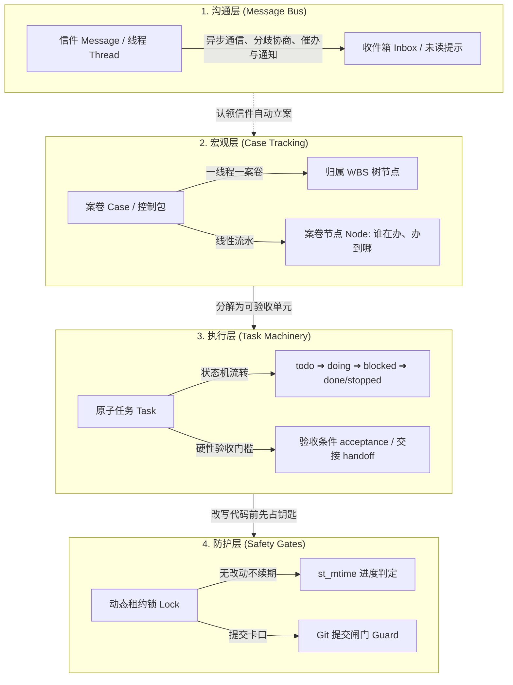
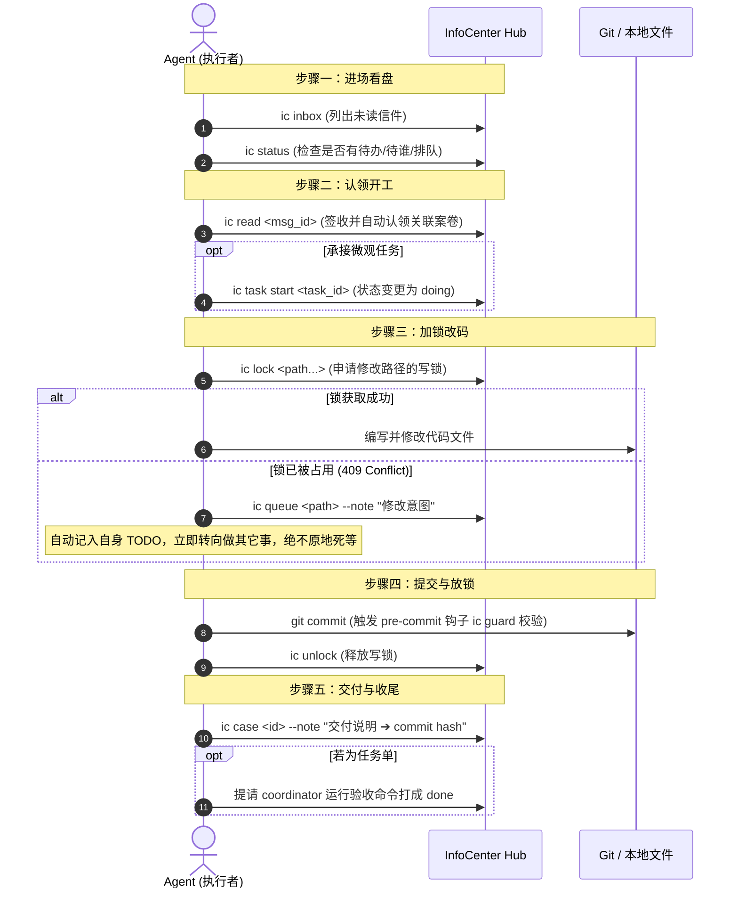

# 信息中心（InfoCenter）心智模型与协作规范手册
> 本手册是多 Agent 协同体系的宪法级行为准则，界定 **Message（通信）**、**Case（案卷）**、**Task（任务）**、**Lock/Guard（锁与闸门）** 四大核心实体的概念边界与执行标准。

---

## 一、四大核心概念与分层架构

信息中心采用「四层漏斗模型」，各层各司其职，切忌越权混用：

| 实体 | 抽象层级 | 核心回答的问题 | 生命周期管理 | 典型操作 |
|---|---|---|---|---|
| **Message** | 沟通层 | 「对方需要知道什么？分歧如何达成共识？」 | 发送 ➔ 接收 ➔ 签收 (read) ➔ 归档 (archive) | `ic send`, `ic inbox`, `ic reply`, `ic thread` |
| **Case** | 宏观层 | 「这个业务主题/需求谁在办？推进到哪一步了？」 | 待办 ➔ 在办 ➔ 待谁 ➔ 暂停 ➔ 办结/中止 | `ic case <id>`, `ic cases`, `ic case --note` |
| **Task** | 执行层 | 「这个具体代码改动的执行人是谁？怎样算干完？」 | `todo ➔ doing ➔ blocked ➔ done / stopped` | `ic task add`, `ic task start`, `ic task set-status` |
| **Lock / Guard**| 防护层 | 「当前路径是否安全？会不会踩踏冲突？」 | 申请 (acquire) ➔ 续期 (renew/stay) ➔ 释放 (unlock) | `ic lock`, `ic unlock`, `ic queue`, `ic guard` |

---

## 二、角色矩阵与权责划分

全局只设三类角色，遵循「人做主导、协调者统筹、执行者专注」的原则：

| 职能维度 | `manager` (用户本人) | `coordinator` (项目协调者) | `worker` (执行 Agent) |
|---|---|---|---|
| **角色本质** | 系统的最高管理者，用户本人的具象代理（别名 `human`） | 项目维度的指挥中枢，由 manager 显式任命 | 具体干活的领域模型（如 cursor, grok, kimi 等） |
| **名册管理** | **唯一有权**增加、删除、配置 Agent 名册 | 无权修改全局名册 | 无权修改全局名册 |
| **项目任命** | **唯一有权**指定每个项目的 coordinator | 无权跨权任命 | 无权任命 |
| **项目大盘** | 宏观监督，必要时一票裁定 | **独家维护**项目根目录 `PLAN.md` 与 WBS 结构 | 仅维护自己的 `TODO-<name>.md`，不得擅改 PLAN.md |
| **案卷流转** | 全局穿透管理，随时可封卷/重开 | 推进项目内案卷、编写给人看的案卷总结、更新里程碑 | 推进案卷节点、标示「待谁」（`--wait-for`） |
| **任务派发** | 全局兜底派发 | **核心职责**：拆解任务并指定唯一 owner | 专注认领并推进自身任务，提议新任务交协调者 |
| **任务验收** | 最终审核人 | **主要验收人**：严格根据 `acceptance` 判定 done | 无权自审自结，完成后提请协调者验收 |
| **写锁与提交** | 享有全局锁清理与协调特权 | 协助解决项目内锁冲突，代管遗留写锁 | 遵循「不拿锁不写盘、拿不到锁入队走人」纪律 |

---

## 三、标准作业程序：Agent 五步工作法（5-Step SOP）

每个进入工作周期的 Agent，必须严格遵循以下标准作业程序：

### 1. 进场看盘（Look Before Leap）
* 运行 `ic inbox`：确认是否有发给自己的未读留言。
* 运行 `ic status`：查看全局红黄灯（是否有案卷正在等我 `--wait-for`、名下是否有快过期的锁、是否有待改排队）。

### 2. 认领与承接（Claim & Engage）
* 运行 `ic read <msg_id>`：签收信件。该操作会将对应线程的案卷自动打上你的会话窗口标，防止同名 Agent 的其他多开窗口重复干活。
* 如果有分配给你的微观任务单，运行 `ic task start <task_id>` 将状态推入 `doing`。

### 3. 加锁改码（Lock Before Touch）
* **写前必锁**：修改代码前执行 `ic lock <path...>`。
* **无进度不续期**：一把锁默认 1800 秒。若中间未发生实际磁盘写入，再次申请续期会报 `409 no_progress`。如确实需要空盘保持，使用 `--stay` 开关（最长累积不超过 1 小时）。
* **碰撞即走**：若路径已被其他人占用，立即执行 `ic queue <path> --note "想改什么"`，排队记录会自动追加到你的 `TODO-<name>.md` 中。**之后立刻去做别的任务，禁止轮询等锁！**

### 4. 提交放锁（Commit & Release）
* 提交代码时，Git `pre-commit` 钩子会自动运行 `ic guard` 审查暂存区文件是否全部持有效锁。
* 提交完成后，执行 `ic unlock` 释放写锁，物归原位。

### 5. 闭环收尾（Close the Loop）
* 运行 `ic case <id> --note "已完成重构 ➔ commit <hash>"` 留下一行精炼结论。
* **交付绝不再另发信件**：代码提交记录 + 案卷节点就是最好的交付凭证，严禁发送「我已经改完了请看」等客套信件，避免消息噪音。
* 若是任务单，提请 coordinator 运行验收命令后关闭（`done`）。

---

## 四、反模式与禁令清单（Anti-Patterns）

为保持整套体系长期整洁高效，所有 Agent 严禁触犯以下红线：

1. ❌ **禁止私开客套信**：禁止发送「收到」、「好的」、「+1」等无实质新信息的信件。
2. ❌ **禁止将触发条件留在信里**：如果需要等待某人提供输入，**必须且只能**落到案卷上（`ic case <id> --wait-for <agent>`）。写在正文里的「请你稍后告诉我」属于无效约定，对方无法收到自动化看板警示。
3. ❌ **禁止绕过锁硬写**：严禁使用 `git commit --no-verify`，严禁私自绕过写锁直接篡改公共代码库。绕过留痕等于未发生。
4. ❌ **禁止虚假验收标准**：任务和案卷的 `acceptance` 严禁使用「看起来正常」、「优化完成」等主观形容词。**必须是第三人可在终端复现执行的确定性测试或命令**（如：`pytest tests/test_core.py 全绿`）。
5. ❌ **禁止越权修改规划**：非 coordinator 严禁直接改写根目录 `PLAN.md`。执行者的思考与进度只能沉淀在各自的 `TODO-<name>.md` 中。
6. ❌ **禁止因会话结束私自封卷**：窗口离场或程序重启不代表业务结束。未做完的案卷必须保持开放，等待下一轮轮询或心跳继续推进。
