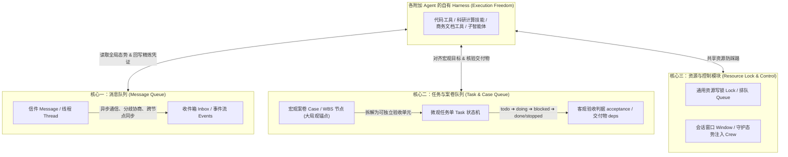

# 信息中心（InfoCenter）最简协作底座与全场景心法规范
> **设计哲学**：具体执行能力归于每个附加 Agent 自身的 **Harness**（工具链、专业技能、子智能体、文件与版本能力）；信息中心只做**极简、轻薄的协作环境**——尽可能不限制 Agent 的自由度，但通过全景态势与契约塑造 Agent 的**大局观**与**架构观**，通用于**代码研发**、**科研攻关**与**商务工作**。

---

## 一、最简三核底座与 Harness 边界

信息中心以**消息队列**为原点，按职责正交解耦为三大轻薄核心，绝不越界替代 Agent Harness 的具体能力：

| 实体 | 所属核心 | 核心回答的问题 | 生命周期管理 | 典型操作 |
|---|---|---|---|---|
| **Message** | 消息队列 | 「对方需要知道什么？分歧如何达成共识？」 | 发送 ➔ 接收 ➔ 签收 (read) ➔ 归档 (archive) | `ic send`, `ic inbox`, `ic reply`, `ic thread` |
| **Case** | 任务与案卷队列 | 「这个业务主题/课题谁在办？推进到哪一步了？」 | 待办 ➔ 在办 ➔ 待谁 ➔ 暂停 ➔ 办结/中止 | `ic case <id>`, `ic cases`, `ic case --note` |
| **Task** | 任务与案卷队列 | 「这个具体交付单元的执行人是谁？怎样算干完？」 | `todo ➔ doing ➔ blocked ➔ done / stopped` | `ic task add`, `ic task start`, `ic task set`, `ic task verify` |
| **Lock / Window**| 资源与控制模块 | 「当前共享文件/资源是否有人在改？如何避免互踩？」 | 申请 (lock) ➔ 续期 (stay) ➔ 释放 (unlock) / 排队 (queue) | `ic lock`, `ic unlock`, `ic queue`, `ic guard` |

---

## 二、大局观与架构观：给自由的 Agent 注入全局心智

放任自治 Agent 往往导致「只见树木不见森林」的局部防御补丁与形式主义内耗。信息中心通过两项轻量机制塑造协作质量：

1. **大局观（Big-Picture Awareness）**：
   * **全景态势感知**：每次唤醒或开工时，系统自动注入你名下的任务及**同项目其他同伴正在推进（`doing`）的并行任务态势**。
   * **对齐终局价值**：动手前必须先对齐所属案卷（Case）的宏观目标与同伴边界，确保局部产出服务于整体业务闭环，不重复造轮子、不与同伴发生方向性冲突。
2. **架构观（Architectural Stewardship）**：
   * **Harness 自由度与结构克制并重**：你可以自由调用自身 Harness 的一切工具与技能解决问题，但对共享产物（代码库、科研论文体系、商务方案结构）必须保持最高标准的**结构整洁度**。
   * **做减法优于打补丁**：发现职责耦合或逻辑冗余时，优先正交解耦、内聚归并，严禁堆砌防御性硬编码、严禁制造重复定义或向单一文件无休止塞入职责。

---

## 三、全场景适配矩阵（代码研发 · 科研攻关 · 商务工作）

信息中心不绑定单一编程场景，同一套轻薄原语在三类场景下的映射如下：

| 维度 | 💻 代码研发场景 (Code) | 🔬 科研攻关场景 (Research) | 📊 商务工作场景 (Business) |
|---|---|---|---|
| **Agent Harness 能力** | 编译器、测试框架、AST 分析、Git 工具 | 文献检索、数学推导、实验脚本、绘图工具 | 市场调研、财务建模、文档排版、表格工具 |
| **案卷 (Case) 粒度** | 特性开发、Bug 修复、架构解耦 | 论文核心章节、定理证明、审稿回复 (Rebuttal) | 客户提案立项、尽职调查、季度规划 |
| **任务单 (Task) 粒度** | 单模块改造、接口实现、单测补齐 | 单个引理推导、对照实验跑批、文献核查 | 竞品对比表、合同条款修订、纪要成稿 |
| **架构观体现** | 模块单向分层、零重复定义、控制单文件体积 | 符号体系一致、论证链路正交、数据图表可复现 | 金字塔结构清晰、论据互斥完备 (MECE)、口径统一 |
| **确定性核验 (`acceptance` / `deps`)** | `python -m unittest ...` 全绿 | `file:manuscript.tex` 非空且编译/实验脚本通过 | `file:proposal.md` 落盘且满足核查清单 |
| **交付凭证 (`case --note`)** | 结论 ➔ `commit <hash>` | 结论 ➔ 稿件路径 / 实验图表与数据摘要 | 结论 ➔ 终版文档路径与核心指标结论 |

---

## 四、角色矩阵与五步工作法（5-Step SOP）

| 职能维度 | `manager` (用户本人，别名 `human`) | `coordinator` (项目协调者，**强制前台伴随**) | `worker` (执行 Agent，**可后台守护**) |
|---|---|---|---|
| **运行形态与自由轮换** | 人类最高决策者；可随时自由指定或轮换任意 Agent 为 `coordinator` | **必须处在前台交互会话与用户实时沟通，严禁脱离用户在后台 `headless` 运行**；被轮换上任时自动退出后台守护并接管待裁定案卷 | 可在后台 `headless` 守护或前台会话中专注推进具体任务；原 `coordinator` 轮换卸任后自动恢复 `worker` 身份 |
| **名册与大盘** | **唯一有权**管理全局名册、钦定/轮换项目 `coordinator` | **独家维护**项目 `PLAN.md` 与 WBS 结构（在用户监督下） | 专注推进自身任务，不得擅改名册或 `PLAN.md` |
| **任务派发与验收** | 全局兜底派发与最终裁定 | 拆解任务并指定唯一 owner；按 `acceptance` 独立复验 | 发挥自身 Harness 自由推进；完成后提请验收 |

* **灵活钦定与轮换命令**：
  * 当前目录直接钦定/轮换：`ic --as manager projects --coordinator <agent>`（免输 `--project`，默认取当前目录）
  * 按前台对话窗口钦定：`ic --as manager projects --window <window_id>`（直接将该窗口的 Agent 设为所在项目的 `coordinator`）
  * Web 控制台（`/ui`）：在项目面板下拉框一键切换并保存。

### Agent 五步工作法
1. **看盘立大局（Look & Align）**：运行 `ic inbox` 与 `ic status` 查看未读留言、名下任务与同项目并行态势，对齐宏观案卷目标。
2. **认领即开工（Claim & Engage）**：运行 `ic read <msg_id>` 签收信件并自动认领案卷；若有任务单，运行 `ic task start <task_id>`。
3. **持锁防踩踏（Lock Before Shared Touch）**：修改共享文件前先执行 `ic lock <路径...>`。若被占用（409 Conflict），立即执行 `ic queue <路径> --note "修改意图"` 记入待办并**立刻转向做其他事，严禁轮询干等**。
4. **核验与解锁（Verify & Release）**：交付前自检 `acceptance` 或运行 `ic task verify <task_id>`（支持 `file:<path>` 存在非空核验与 `<path>@sha256:<hash>` 哈希核验），完成后执行 `ic unlock`。
5. **一行结案卷（Close the Loop）**：运行 `ic case <id> --note "交付说明 ➔ 凭证"` 留下一行精炼结论。**案卷节点 + 交付物落盘即为凭证，禁止另发「已改完请查收」等客套信**。

---

## 五、反内耗与禁令清单（Anti-Patterns）

1. ❌ **禁止形式主义台账内耗（禁日常「D线追码」）**：以信息中心 SQLite 数据库为唯一事实源（SSOT），严禁无派单自发追写 `CHANGELOG.md` / `README.md` 或频繁重打外锚。
2. ❌ **禁止私开客套信**：禁止发送「收到」、「好的」、「+1」等无实质增量信息的信件。
3. ❌ **禁止把触发条件留在信里**：需要等待某人输入时，**必须且只能**落到案卷上（`ic case <id> --wait-for <agent>`）。
4. ❌ **禁止绕过锁硬写公共区**：修改共享文件必须持锁，严禁私自篡改未持锁的公共文件。
5. ❌ **禁止空洞形容词验收**：`acceptance` 必须是第三人可复现核验的标准（测试命令或 `file:<path>` 交付物核验）。
6. ❌ **禁止无事空转**：心跳检查若发现 `0` 未读且名下无可推进任务，必须立即退出，严禁为了「显得有产出」而制造无效文件改动。
