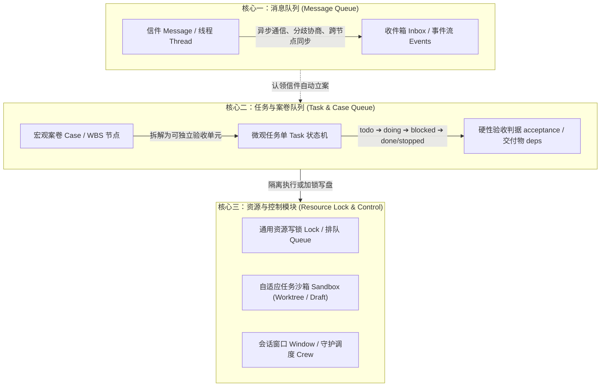

# 信息中心（InfoCenter）最简架构与全场景协作规范
> 本手册界定信息中心的三大解耦核心（**消息队列**、**任务与案卷队列**、**资源与控制模块**），以及在**代码研发**、**科研攻关**、**商务工作**三大场景下的统一执行标准。

---

## 一、最简三核架构与实体边界

信息中心以**消息队列**为原点，按职责正交解耦为三大宏观结构：

| 实体 | 所属核心 | 核心回答的问题 | 生命周期管理 | 典型操作 |
|---|---|---|---|---|
| **Message** | 消息队列 | 「对方需要知道什么？分歧如何达成共识？」 | 发送 ➔ 接收 ➔ 签收 (read) ➔ 归档 (archive) | `ic send`, `ic inbox`, `ic reply`, `ic thread` |
| **Case** | 任务与案卷队列 | 「这个业务主题/课题谁在办？推进到哪一步了？」 | 待办 ➔ 在办 ➔ 待谁 ➔ 暂停 ➔ 办结/中止 | `ic case <id>`, `ic cases`, `ic case --note` |
| **Task** | 任务与案卷队列 | 「这个具体交付单元的执行人是谁？怎样算干完？」 | `todo ➔ doing ➔ blocked ➔ done / stopped` | `ic task add`, `ic task start`, `ic task set`, `ic task verify` |
| **Lock / Sandbox**| 资源与控制模块 | 「当前文件/资源是否安全？是否在独立沙箱推进？」 | 申请 (lock/sandbox) ➔ 续期 ➔ 核验合入/释放 (unlock) | `ic lock`, `ic unlock`, `ic queue`, `ic guard`, `ic task sandbox` |

---

## 二、全场景适配矩阵（代码研发 · 科研攻关 · 商务工作）

信息中心不绑定单一编程场景，同一套原语在三类场景下的映射如下：

| 维度 | 💻 代码研发场景 (Code) | 🔬 科研攻关场景 (Research) | 📊 商务工作场景 (Business) |
|---|---|---|---|
| **典型项目 (Workspace)** | Git 代码仓库 | 论文手稿目录、实验数据与推导目录 | 商业方案、合同审阅、市场调研目录 |
| **案卷 (Case) 粒度** | 特性开发、Bug 修复、架构重构 | 论文核心章节、定理证明、审稿回复 (Rebuttal) | 客户提案立项、尽职调查、季度规划 |
| **任务单 (Task) 粒度** | 单模块改造、接口实现、单测补齐 | 单个引理推导、对照实验跑批、文献核查 | 竞品对比表、合同条款修订、纪要成稿 |
| **推荐隔离方式** | `ic task sandbox`（自动建 Git Worktree）或文件锁 | `ic task sandbox`（独立草稿沙箱）或章节文件锁 | `ic task sandbox`（独立草稿沙箱）或文档写锁 |
| **确定性验收 (`acceptance` / `deps`)** | `python -m unittest ...` 全绿 | `file:manuscript.tex` 非空且编译/脚本复现通过 | `file:proposal.md` 落盘且满足核查清单 |
| **交付凭证 (`case --note`)** | 结论 ➔ `commit <hash>` | 结论 ➔ 稿件路径 / 实验图表与数据摘要 | 结论 ➔ 终版文档路径与核心指标结论 |

---

## 三、角色矩阵与权责划分

全局只设三类角色，遵循「人做主导、协调者统筹、执行者专注」的原则：

| 职能维度 | `manager` (用户本人，别名 `human`) | `coordinator` (项目协调者) | `worker` (执行 Agent) |
|---|---|---|---|
| **名册与任命** | **唯一有权**管理全局名册、任命各项目 coordinator | 无权修改全局名册或跨权任命 | 无权修改名册 |
| **项目大盘** | 宏观监督，必要时一票裁定 | **独家维护**项目 `PLAN.md` 与 WBS 结构 | 专注推进自身任务，不得擅改 `PLAN.md` |
| **任务派发与验收** | 全局兜底派发与最终审核 | 拆解任务并指定唯一 owner；按 `acceptance` 独立复验 | 认领推进自身任务；完成后提请协调者验收 |
| **资源与冲突协调** | 享有全局锁清理与进程控制特权 | 协助解决项目内资源锁冲突与沙箱合入 | 遵循「改前拿锁或进沙箱、碰撞入队即走」纪律 |

---

## 四、标准作业程序：Agent 五步工作法（5-Step SOP）

1. **进场看盘（Look Before Leap）**：
   * 运行 `ic inbox` 查看未读留言；运行 `ic status` 查看全局指示灯（是否有案卷在等我 `--wait-for`、名下任务与排队状态）。
2. **认领开工（Claim & Engage）**：
   * 运行 `ic read <msg_id>` 签收信件并自动认领关联案卷。
   * 若有分配的微观任务单，运行 `ic task start <task_id>`（如需隔离工作区可运行 `ic task sandbox <task_id>`）。
3. **隔离执行或加锁修改（Sandbox or Lock Before Touch）**：
   * **共享目录直接修改**：先执行 `ic lock <路径...>`。若被占用（409 Conflict），立即执行 `ic queue <路径> --note "修改意图"` 记入待办，**立刻转向做其他事，严禁轮询干等**。
   * **任务沙箱隔离修改**：在 `ic task sandbox <task_id>` 创建的独立目录（Git Worktree 或独立草稿目录）中自由读写，互不污染。
4. **验证与释放（Verify & Release）**：
   * 交付前自检 `acceptance` 判据或运行 `ic task verify <task_id>` 校验交付物（支持 `file:<path>` 存在非空校验与 `<path>@sha256:<hash>` 哈希校验）。
   * 若在主工作区持锁修改，完成后执行 `ic unlock` 释放写锁；若在沙箱修改，可运行 `ic task sandbox <task_id> --apply` 归档交付物。
5. **闭环收尾（Close the Loop）**：
   * 运行 `ic case <id> --note "交付说明 ➔ 凭证"` 留下一行精炼结论。
   * **交付不另发客套信**：案卷节点 + 交付物落盘即为凭证，禁止再发「已改完请查收」等重复信件。

---

## 五、反内耗与禁令清单（Anti-Patterns）

1. ❌ **禁止形式主义台账内耗（禁日常「D线追码」）**：以信息中心 SQLite 数据库（`ic status` / `ic cases` / `ic tasks`）为唯一事实源（SSOT）。严禁在无明确派单时自发追写 `CHANGELOG.md` / `README.md` 或频繁重打外锚。
2. ❌ **禁止私开客套信**：禁止发送「收到」、「好的」、「+1」等无实质增量信息的信件。
3. ❌ **禁止把触发条件留在信里**：需要等待某人输入时，**必须且只能**落到案卷上（`ic case <id> --wait-for <agent>`）。
4. ❌ **禁止绕过锁硬写公共区**：在公共工作区修改文件必须持锁，严禁私自篡改未持锁的公共文件。
5. ❌ **禁止空洞形容词验收**：任务和案卷的 `acceptance` 必须是第三人可复现核验的标准（代码场景为测试命令，科研/商务场景为可核验的交付物路径或量化清单）。
6. ❌ **禁止无事空转**：心跳检查若发现 `0` 未读且名下无可推进任务，必须立即退出，严禁为了「显得有产出」而制造无效文件改动。
