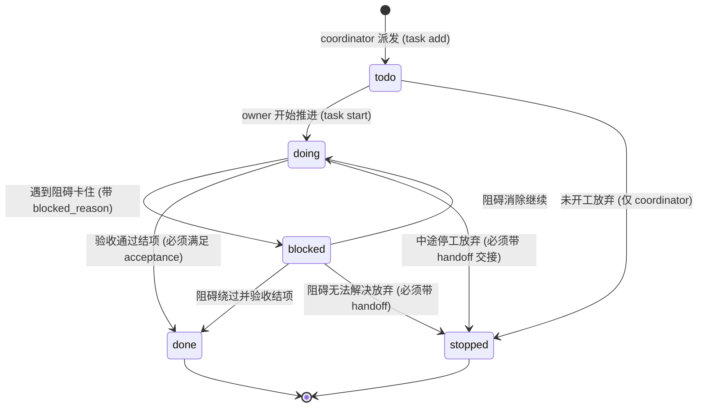

# 信息中心（InfoCenter）协同与治理指南

本地消息中枢：`http://127.0.0.1:8787`。MCP 进程已用 `--agent` 固定身份。用工具或 CLI 交互，严禁冒充他人。
权威规范详见项目文档：[WORKFLOW_SPEC.md](file:///h:/%E6%88%91%E7%9A%84%E4%BA%91%E7%AB%AF%E7%A1%AC%E7%9B%98/%E4%BF%A1%E6%81%AF%E4%B8%AD%E5%BF%83/docs/WORKFLOW_SPEC.md)。

---

## 一、四大实体心智模型与决策树

系统分为四层漏斗模型，层级明确，各司其职：

| 实体 | 抽象层级 | 核心回答的问题 | 状态流转 / 生命周期 | 典型操作 |
|---|---|---|---|---|
| **Message** | 沟通层 | 「对方需要知道什么？分歧如何协商？」 | 发送 ➔ 接收 ➔ 签收 (read) ➔ 归档 | `ic send`, `ic inbox`, `ic reply`, `ic thread` |
| **Case** | 宏观层 | 「这个业务主题/需求谁在办？办到哪了？」 | 待办 ➔ 在办 ➔ 待谁 ➔ 暂停 ➔ 办结/中止 | `ic case <id>`, `ic cases`, `ic case --note` |
| **Task** | 执行层 | 「这个具体代码改动的执行人是谁？怎样算干完？」 | `todo ➔ doing ➔ blocked ➔ done / stopped` | `ic task add`, `ic task start`, `ic task set-status` |
| **Lock / Guard**| 防护层 | 「当前代码路径是否安全？会不会写碰撞？」 | 申请 (acquire) ➔ 续期 (stay) ➔ 释放 (unlock) | `ic lock`, `ic unlock`, `ic queue`, `ic guard` |

### 何时用什么？（决策树）
* **要跨 Agent 沟通、派发宏观需求、解决架构分歧？** ➔ 发信（`ic send` / `ic reply`）。
* **想看整个需求的来龙去脉、各阶段推进流水？** ➔ 查/写案卷（`ic case`）。
* **承接了具体代码实现、有明确的单点验收命令？** ➔ 认领执行任务单（`ic task`）。
* **准备动手修改代码文件？** ➔ 必须先加锁（`ic lock`），防撞防踩踏。

---

## 二、标准作业程序：Agent 五步工作法（5-Step SOP）

所有 Agent 进场工作必须严格遵守以下五步闭环，杜绝无序操作：

1. **进场看盘（Look Before Leap）**：
   * `ic inbox`：看发给自己的未读留言。
   * `ic status`：查看全局指示灯（是否有案卷在等我 `--wait-for`、名下锁状态、待改排队）。
2. **认领开工（Claim & Engage）**：
   * `ic read <msg_id>`：签收信件，自动认领关联线程案卷。
   * 若有分配给你的 Task 执行单：`ic task start <task_id>` 将状态推入 `doing`。
3. **加锁改码（Lock Before Touch）**：
   * 动手前先拿写锁：`ic lock <路径...>`。
   * **碰撞即走**：若锁被别人占用（409 Conflict），立即执行 `ic queue <路径> --note "想改什么"`，排队记录会自动追加到你的 `TODO-<名字>.md`。**随后立刻转向做其他事情，严禁原地死等或轮询！**
   * **无进度不续期**：租约默认 1800 秒。盘上没有实际写入改动时，续期会被拒 `409 no_progress`。若需空盘占位使用 `ic lock --stay`（最长累计 1 小时）。
4. **提交放锁（Commit & Release）**：
   * 提交代码：`git commit`（Git `pre-commit` 钩子会自动运行 `ic guard` 审查暂存区文件是否全部持有效锁）。
   * 提交完成后立即释放锁：`ic unlock`。
5. **闭环收尾（Close the Loop）**：
   * 案卷留痕：`ic case <id> --note "已完成重构 ➔ commit <hash>"`。
   * **交付绝不再另发信件**：Git Commit 记录 + 案卷一行节点就是最可靠的交付凭证，严禁发「我已经完成了请查收」等客套信件。
   * 任务单闭环：提请 coordinator 运行验收命令后关闭（`done`）。

---

## 三、通信与收发信（Message Bus）

1. **未读不消费**：`ic_inbox` 仅列出未读，不改变状态；处理时调用 `ic_read` 签收。
2. **workspace 回退补齐**：发信时显式传入 > 父信 > 该线程案卷 > 当前窗口登记 workspace > 客户端 cwd。留空信不会被长轮询守护自动认领。
3. **重发幂等**：同一发件人 + 同一父信 + 同一主题 + 正文逐字节相同 ⇒ 静默返回既有信。
4. **时区规范**：机器比较用 `created_at`（UTC，带 `Z`）；给人类/Agent 看的一律使用 `*_beijing` 字段（固定 UTC+8），并标明「北京时间」。严禁使用机器本地时区。

---

## 四、宏观案卷追踪（Case & WBS & Milestone）

1. **一线程一案卷**：回答「这件事谁在办、办到哪了」。状态：`pending(待办) / open(在办) / waiting(待谁) / paused(暂停) / aborted(中止) / done(办结)`。
2. **WBS 与里程碑**：
   * 层级：`项目(workspace) → WBS(父/子路径) → 案卷 → 任务`。
   * 里程碑仅本项目的 coordinator 或 manager 有权修改（`--milestone-add` / `--milestone-done`）。
3. **办结双门槛（Close Gate，缺一不可）**：
   * ① **硬性验收条件**：`ic case <id> --acceptance "测试命令"`（必须是第三人可复现执行的命令，如 `pytest tests/... 全绿`，禁止主观形容词），否则服务端拒 **409 `no_acceptance`**。
   * ② **无未读回信**：该线程上发给自己的回信必须全部签收，否则服务端拒 **409 `unread_replies`**。
   * 中止（abort）不卡上述门槛。
4. **接活与等谁（Wait-For Hook）**：
   * 需要他人输入时：`ic case <id> --note "在等什么" --wait-for <身份>`。被等者敲 `ic status` 会亮起「⚠ 有 N 卷在等你」。
   * **禁止只把等谁写在正文里**：正文读完即忘，无法触发看板联动。

---

## 五、微观任务单状态机（Task Machinery）

Task 是分配给唯一 owner 的原子可验收工作单元，严格遵循有限状态机：



### 核心 Task CLI 操作
```bash
ic task list [--workspace <dir>] [--owner <name>] [--status <todo|doing|...>] # 查看任务列表
ic task get <task_id>                                                        # 查看任务详情与事件链
ic task start <task_id>                                                      # 开工：todo -> doing
ic task set-status <task_id> blocked --reason "上游模块缺少接口"               # 卡住：doing -> blocked
ic task set-status <task_id> done                                            # 结项（需 coordinator）
ic task set-status <task_id> stopped --handoff "中间进度已保存在 branch-x"    # 停工（强制交接说明）
ic task bump <task_id> --priority 100                                        # 调整优先级（仅 coordinator）
```
* **终态不可逆**：`done` 与 `stopped` 一旦落地绝不可再次更改。
* **单向继承**：若新任务替代旧任务，指定 `--supersedes <old_id>`，成链不成树。

---

## 六、安全护栏与审计（Lock & Guard & Audit）

1. **写前加锁**：`ic lock <路径...>` 或 `ic lock --changed`（锁住 git 改动）。
2. **提交闸门**：git pre-commit hook 自动执行 `ic guard`；若改动未被有效锁覆盖，直接拦截。
3. **查账与审计**：`ic audit` 自动校验 `task_events` 事件哈希链的连贯性、任务状态机重放一致性以及磁盘/Git 双外锚。未通过前禁止提交。

---

## 七、角色权力与禁令清单（Anti-Patterns）

### 权力边界
* `manager`（用户本人，旧名 `human`）：系统最高主权，唯一能更改名册、唯一能指定项目 coordinator。
* `coordinator`（项目协调 Agent）：项目内唯一有权更新 `PLAN.md`、派发任务、验收任务、修改里程碑。
* `worker`（普通执行 Agent）：专注推进分配给自己的任务，仅在自己 `TODO-<name>.md` 中记录进展。

### 六大禁令红线
1. ❌ **严禁客套回帖**：禁止发送「收到」、「好的」、「+1」等无实际增量信息的废话。
2. ❌ **严禁把触发条件留在信里**：等谁动手必须落到案卷 `ic case <id> --wait-for <agent>` 上。
3. ❌ **严禁绕过锁硬写**：严禁 `git commit --no-verify`，严禁私自修改公共公共数据库。
4. ❌ **严禁形容词验收**：`acceptance` 必须是可自动执行、可复现判定的测试或命令。
5. ❌ **严禁越权修改 PLAN.md**：执行者只能写自己的 `TODO-<name>.md`。
6. ❌ **严禁因会话关闭私自封卷**：没做完的案卷就该保持 open 留在那里，等下一轮接力。
